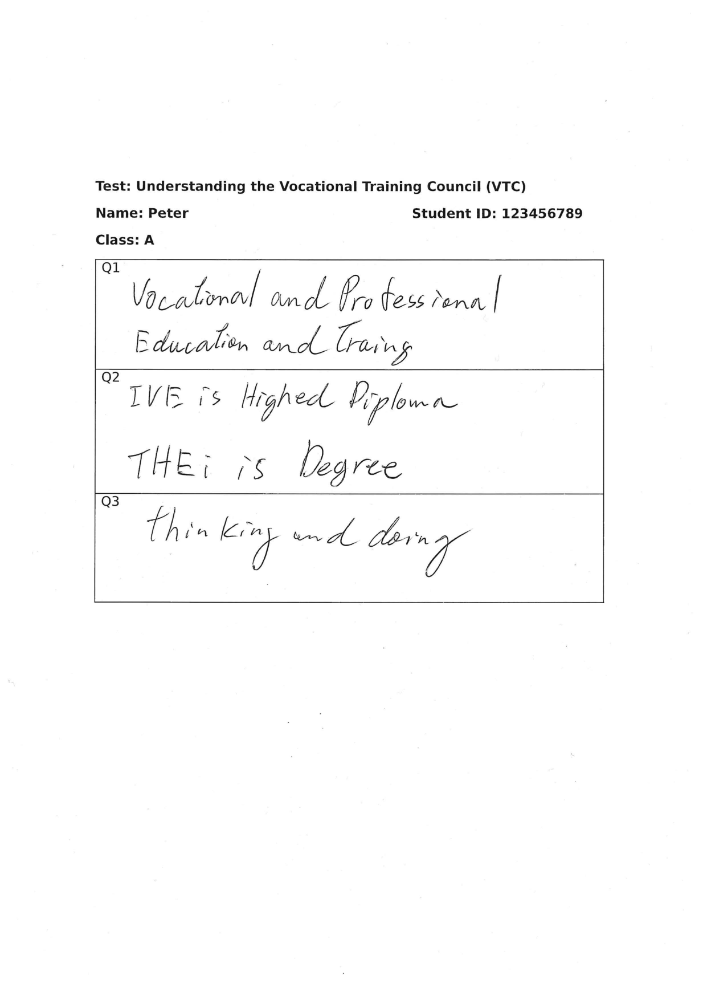
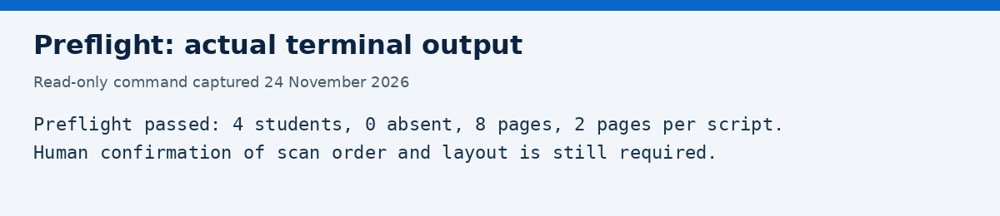

# An agent skill for teacher-reviewed handwriting grading on Azure

*Part 1 of 8 · Agent skills, Python tools and human review*


The teacher should describe the intended outcome, not remember a sequence of
terminal commands. An **agent skill** gives the assistant reusable guidance for
interpreting that request, inspecting an exam workspace, selecting Python tools
and stopping at decisions that belong to the teacher.

The [Azure Handwriting Grader Skills](https://github.com/wongcyrus/azure-handwriting-grader-skills)
repository contains three distinct layers. `skills/handwriting-grading/SKILL.md`
guides a skill-capable assistant such as Copilot CLI. The Python package provides
the executable tools and validation. Microsoft Agent Framework coordinates the
default **grading** operation; Azure OpenAI receives task-specific document/image
prompts inside that engine. These are not interchangeable meanings of "agent."

Our example is **four students, eight scanned pages, five questions and 50 possible marks**. Each student has two pages. We inspect an existing VTC-themed assessment and its retained outputs, rather than invent a successful new run.

## What makes this an agent skill, rather than a command list?

The published skill has frontmatter identifying its task and limits:

```yaml
name: handwriting-grading
description: >-
  Guides preparation and human review of scanned handwriting grading with
  Azure OpenAI Handwriting Grader. Use for exam configuration, input validation,
  rubric and bounding-box review, grading review, reports, or safe planning
  of student-score distribution. Does not provide a general OCR service or
  authorize automated grading or email.
```

The description identifies when the skill is relevant; the body supplies workflow
decisions, safety instructions and links to detailed references. This actual
excerpt from [SKILL.md](../../skills/handwriting-grading/SKILL.md) defines the
assistant's first task:

```markdown
Establish whether the user is starting or resuming, what stage they need,
and which local paths they intend to use. Do not copy or overwrite data.
```

The skill is **instructions**, not executable Python and not a grant of
permission. It tells the assistant to inspect artifacts and ask for missing
decisions instead of blindly starting at command one. Reference files explain
rubrics, regions, grading, pricing and distribution without turning every user
request into a giant prompt containing the whole repository.

For Copilot CLI, register the repository's directory of skills once:

```bash
copilot skill add "/path/to/azure-handwriting-grader-skills/skills"
```

Copilot CLI documents custom skill directories, as well as project/personal
skill locations; `/skills list` lets the user inspect available skills.
The repository's plain `skills/` directory is not one of the documented automatic
project locations, so do not assume cloning alone loads it. Registering the
directory makes the instructions available; it does not install the Python
package, configure Azure or execute an exam. An IT colleague separately prepares
the locked Python environment and private deployment configuration.

## One teacher request, several skill-guided decisions

**Illustrative teacher request, not a captured agent transcript**

```text
Use the handwriting-grading skill to inspect the existing example exam.
Work out its current stage from the saved artifacts.
Explain whether it is ready for grading, show the supporting pages and rubric,
and stop at any unresolved scan or approval problem. No paid calls or email.
```

The assistant should resolve the exam paths, inspect the existing output folder,
read the relevant skill references and choose **read-only** checks. It should not
create a second run or infer that saved approvals authorize fresh inference.
The following sequence explains the published skill's intended behavior; the
outputs are actual saved artifacts/read-only checks, not invented assistant turns.

### Inspect the page before interpreting the configuration



*Figure 1. Actual page 1 rendered from `example/VTC Test.pdf`, not a generated illustration.*

The page image is the starting evidence. Check that the entire answer area is visible, the handwriting is readable, and the page belongs to the expected layout. Do not judge crop quality from a small thumbnail; enlarge the original image.

**Output to inspect:** the scanned page. **Decision:** can the exam be read and divided into the intended two-page scripts? A filename alone cannot answer that question.

### Let Python check structure, then interpret its limited result

This is the tool boundary used for the captured read-only check. It shows what
the assistant can invoke, not another instruction the teacher must type:

```bash
handwriting-grader preflight --exam example/example.yaml
```

**Observed output**

```text
Preflight passed: 4 students, 0 absent, 8 pages, 2 pages per script.
Human confirmation of scan order and layout is still required.
```



*Figure 2. A rendered copy of real terminal output, not a product-interface screenshot.*

Preflight establishes basic structural consistency. Four expected students and eight pages fit a two-page-per-script configuration. It does not establish that each page is upright, correctly ordered or correctly associated with a student.

This distinction matters: a green structural check is not permission to stop looking.

### Apply the skill's stop rule to the scan-check result

```bash
handwriting-grader check-scans --exam example/example.yaml
```

**Observed output, shortened**

```text
Scan orientation/sequence issues found (3):
- PDF page 1 (Script #1, page 1): out of sequence
- PDF page 3 (Script #2, page 1): out of sequence
- PDF page 5 (Script #3, page 1): out of sequence
```

The full captured message says those pages match template page 2 instead of page 1
and asks for manual correction followed by another check. The command returned a
nonzero exit status. The skill specifically tells the assistant to run this check
before region setup, report exact page/script numbers and **not silently flip or
reorder the PDF**.


*Figure 3. Actual blocker captured while preparing this series.*

**The assistant should stop here and explain the discrepancy.** A detector can be
wrong, so the warning is not proof that the pages are definitely shuffled.
Crucially, the inspected grading route does not automatically rerun `check-scans`;
this prerequisite is part of the skill-guided preparation workflow, not a
scan-check enforcement feature of the Framework Executor. The Python grading
gate separately checks bound approvals. Keeping those responsibilities distinct
avoids claiming that Markdown instructions enforce every policy.

The later articles inspect historical outputs that already exist. We did not rerun paid grading or claim to resolve this blocker during article preparation.

### Explain the rubric branch instead of asking the teacher to choose commands

The existing rubric workbook contains five questions worth ten marks each. Q1 asks students to expand VPET and explain its importance. Its item-specific allocation is 2 marks for the expansion, 4 for practical or specialized skills, and 4 for the workforce benefit.


*Figure 4. A table rendered from actual workbook cells; this is not an Excel screenshot.*

The skill asks the assistant to inspect the source format. A structured XLSX uses
local import/validation; a DOCX requires conversion and optional paid extraction.
The choice follows the actual file, not a conversational guess. A saved workbook
does not prove which route created it. In either branch, the assistant presents
question labels, criteria and maxima for teacher review; it must not manufacture
the `--confirm-reviewed` action.

### Explain what will become an image payload


*Figure 5. An offline visualization of saved annotations on the saved template—not a capture of the browser editor.*

The assistant should explain why a box needs inspection: its pixels, not the
whole PDF, become an answer payload. Handwriting touching a boundary or a NAME box
covering the printed heading can corrupt later OCR. Region preparation is local;
optional model suggestions require separate consent and never approve a box.
Part 4 explains the exact Python crop and proposal prompt.

## Before the first paid request

Only after preparation problems and reviews are resolved should the skill-guided
assistant assemble a grading preview from the private configuration. It explains
the target, transferred data, request estimate and uncertainties, then waits for
cost consent. Python independently requires `--confirm-cost` and valid pricing.
On the default route the CLI then invokes Microsoft Agent Framework; the workflow
returns a draft location, not approved scores.

**The useful result of this first walkthrough is not “AI marked everything.”** It is a visible exam, a verified structural summary, a real scan blocker and reviewable rubric/crop evidence. Knowing when not to run AI is part of a successful workflow.

## Technical walkthrough: what the assistant and application actually do

There are three sources of instruction: the teacher expresses intent, `SKILL.md`
guides the assistant's choices, and Python constructs the Azure task prompt.
Framework also carries a control string, `"grade"`, which is not an LLM prompt.
The teacher's sentence is not sent verbatim to the handwriting model. A request
such as "do not send email" is useful intent; separate delivery operations and
approval checks provide the executable boundary.

### Why preflight is local, not an AI judgment

`cli.check_exam()` reads YAML, checks readable input paths, opens the roster with
`openpyxl`, checks unique IDs and required columns, and reads the PDF page count
with `PdfReader`. If attendance is supplied, it counts the present students.
Its structural comparison is this actual source excerpt:

```python
if roster_count and pdf_count is not None and pages and pdf_count != roster_count * pages:
    errors.append("PDF page count does not equal roster count times pages_per_student")
summary.update(exam=name, students=roster_count, absent=absent_count,
               pdf_pages=pdf_count, pages_per_student=pages)
return errors, summary
```

For the observed example, `4 * 2 == 8`, so this check passes. It cannot distinguish
two correctly ordered pages from two swapped pages. The separate scan checker
compares downsampled ink maps against expected page offsets and rotated
alternatives. In the captured command it uses majority-consensus references from
the PDF, not an AI opinion. This explains why the first command passes while the
second reports a blocker.

**Actual outputs:** the preflight summary and the three scan warnings shown above.
No model prompt is involved in either command.

Read the excerpt as a small contract: `roster_count` is the present-student count,
`pdf_count` comes from the PDF parser, and `pages` is the configured script length.
The `if` appends an error rather than asking a model to judge the mismatch.
`summary.update()` returns evidence the assistant can explain. A skill-guided
assistant must inspect both errors and the summary; a printed count is not
permission to advance to inference.

### The complete optional DOCX-extraction prompt

If the source marking scheme is DOCX rather than a ready-made XLSX, the application
converts it to Markdown and supplies the following **complete production prompt**
from `rubric.PROMPT`. This is current source, not a recovered transcript proving
how the historical workbook was created:

```text
Extract the marking scheme from the document. Return every gradable
question or sub-question as its own separate entry with its exact label,
question text/context, marking criteria, and individual available marks.
Whenever a numbered question contains separately marked sub-parts, sub-items,
or fill-in-the-blank items (each having its own answer space or mark allocation),
split each sub-part into its own entry using its combined label rather than
collapsing multiple sub-parts into one parent entry. Include any general grading
guidance separately. Do not invent missing information.
```

The split-subparts instruction prevents one parent question from swallowing
several separately marked answer spaces. The "do not invent" instruction is not
the only safeguard: the response must also satisfy these source-defined models:

```python
class RubricQuestion(BaseModel):
    question_number: StrictStr
    question_text: StrictStr
    marking_scheme: StrictStr
    marks: float


class ExtractedRubric(BaseModel):
    general_grading_guide: StrictStr = ""
    questions: list[RubricQuestion]
```

`BaseModel` and `StrictStr` are Pydantic types. A `RubricQuestion` represents one
gradable item: its label stays text, its question and criteria stay explicit
strings, and `marks` is the available maximum, not a student score.
`ExtractedRubric` groups those items and retains general guidance separately.
The empty default does not authorize the model to invent missing guidance.
The application supplies the document separately from the instruction:

```python
response = client.generate_content(
    model=model,
    contents=[PROMPT, content],
    config=GenerationConfig(**rubric_config),
)
```

Here `content` is the Markdown conversion, and `rubric_config` requests
`ExtractedRubric` structured output with a 16,384-token output limit. Python then
rejects missing question text, duplicate normalized question IDs, metadata labels
used as question IDs, and nonfinite or nonpositive marks. General guidance is
appended to each question's marking scheme so it reaches later grading prompts.
Source and model-config hashes are checked again before publishing the workbook.

In the call, `model` is the configured Azure deployment alias.
`contents=[PROMPT, content]` separates the stable extraction task from the
document being interpreted. `GenerationConfig(**rubric_config)` expands the
configuration dictionary into the request settings; it is not a second model
or an approval action. The teacher reviews the extracted items against the
source before they can become the rubric used by later grading prompts.

**Actual output available:** the five-question workbook in Figure 4. **Not
captured:** a new DOCX request or its original raw JSON response. The XLSX import
path instead validates and copies a workbook without calling Azure.

### How a region becomes a crop

`prepare_regions()` renders the first script at 200 DPI, records each page's
dimensions and digest, and creates an empty annotation draft. A reviewed box is
stored in the page's pixel coordinates. The example Q3 box is 1191 pixels wide
and 254 pixels high; a label such as `Q3` is normalized to the rubric's question
key before lookup.

Later, `approved_inputs()` checks the rubric and region approvals and requires
the set of question boxes to equal the rubric's question set. Missing Q3 is an
error, not permission to omit that question. Part 4 shows the actual crop code,
optional region-suggestion prompt and coordinate conversion.

This separates four technical responsibilities: the assistant requests an
operation, Python validates its prerequisites, Azure proposes task-specific
content only where needed, and a teacher reviews the resulting artifacts.

Next: [review the existing proposed marks and reports](02-review-and-return.md).


**Implementation reference:** [installation and reviewed workflow at the inspected revision](https://github.com/wongcyrus/azure-handwriting-grader-skills/blob/b6af53dd1cf4cf74b9a50591f0e775a3b1533133/README.md).
