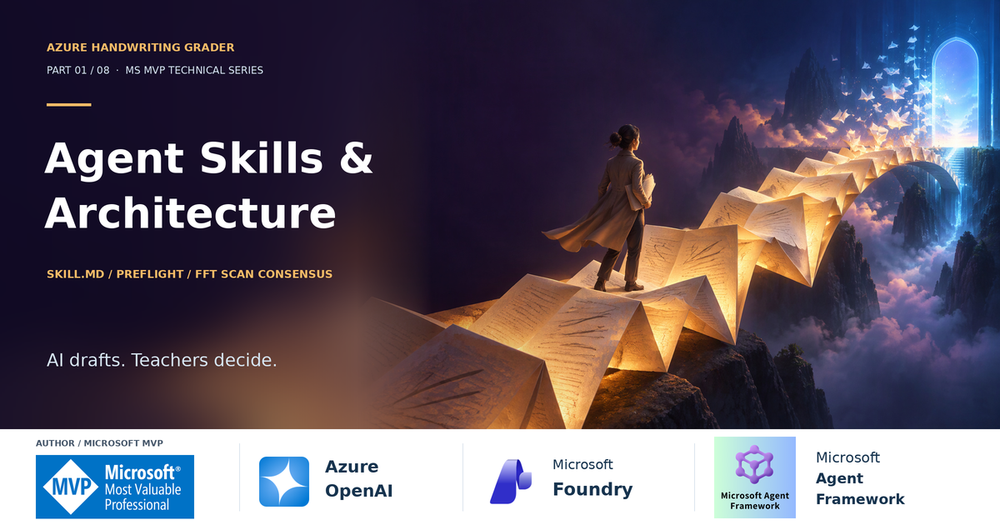
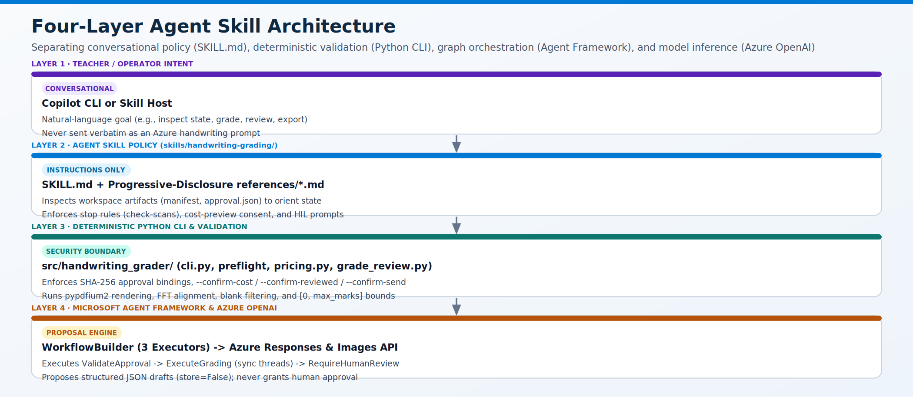
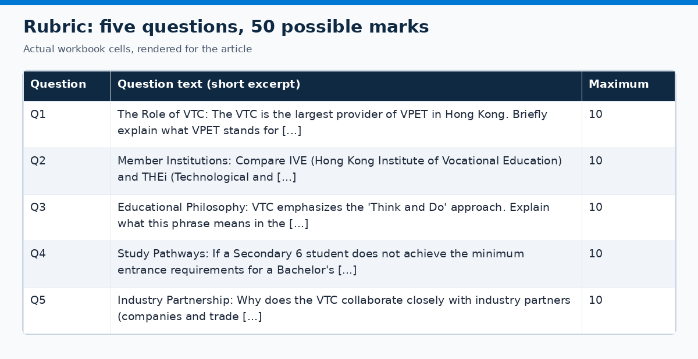
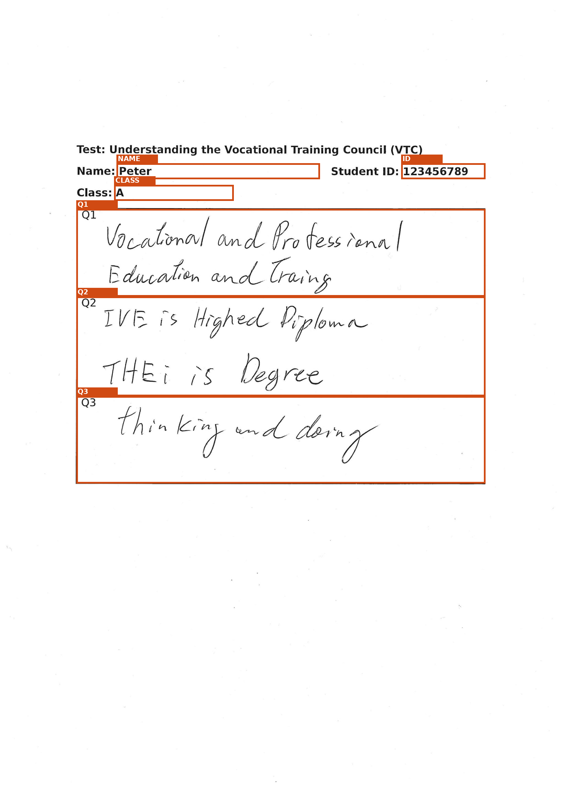

# Designing an Agent Skill for Exam Grading: Architecture, Preflight, and Scan Consensus

*Part 1 of 8 · MS MVP Technical Series · Agent Skills, Deterministic Preflight & Pipeline Design*



When building AI workflows for real-world domains like education, the hardest engineering problem is rarely the model call itself. It is **where the AI stops and deterministic software takes over**.

In [Azure Handwriting Grader Skills](https://github.com/wongcyrus/azure-handwriting-grader-skills), we intentionally separated the system into four distinct layers: teacher intent in a coding assistant (such as GitHub Copilot CLI), reusable **Agent Skill** policy in `skills/handwriting-grading/SKILL.md`, a deterministic **Python CLI**, and **Microsoft Agent Framework** wrapping **Azure OpenAI**. Understanding why these layers are decoupled—and how the pipeline validates inputs before spending a single cloud token—is the foundation of the architecture.



*Figure 1. Four-layer architecture separating conversational skill policy, deterministic Python validation, Agent Framework orchestration, and Azure OpenAI inference.*

## Why an Agent Skill instead of a giant system prompt?

An **Agent Skill** is a portable, progressive-disclosure instruction package—not executable Python and not a security boundary. Its YAML frontmatter tells the host assistant *when* the skill applies:

```yaml
name: handwriting-grading
description: >-
  Guides preparation and human review of scanned handwriting grading with
  Azure OpenAI Handwriting Grader. Use for exam configuration, input validation,
  rubric and bounding-box review, grading review, reports, or safe planning
  of student-score distribution. Does not provide a general OCR service or
  authorize automated grading or email.
```

Instead of stuffing 1,500 lines of CLI flags and edge-case rules into every chat turn, `SKILL.md` uses **progressive disclosure**:
1. **Frontmatter**: Lightweight trigger metadata loaded at startup.
2. **State-oriented router**: A table mapping workspace artifacts (`exam.yaml`, `rubric/approval.json`, `regions/approval.json`, `grading/manifest.json`) to the next valid action.
3. **On-demand `references/*.md`**: Deep guides (`configuration.md`, `regions.md`, `grading.md`, `pricing.md`, `regrading.md`, `email.md`) read only when the user reaches that stage.

This excerpt from [SKILL.md](../../skills/handwriting-grading/SKILL.md) defines how the assistant orients itself:

```markdown
Establish whether the user is starting or resuming, what stage they need,
and which local paths they intend to use. Do not copy or overwrite data.
```

To register the skill in Copilot CLI, an operator adds the `skills/` directory once (`copilot skill add "/path/to/azure-handwriting-grader-skills/skills"`) and verifies with `/skills list`. Cloning the repository alone does not load `skills/` automatically; the skill instructions also never replace Python's executable gates.

## Stage 0 & 1: Answer sheets, path-jail preflight, and attendance

Before any scan is touched, the pipeline supports three deterministic preparation steps:

### 1. Optional printable answer sheets (`answer-sheets`)
When a teacher has a roster and a DOCX template before the exam, `handwriting-grader answer-sheets --exam exam.yaml` merges student metadata into personalized DOCX files (including Word text boxes and hyperlinks) and converts them via local LibreOffice into numbered PDFs and a `combined.pdf` for printing. It runs against the **full roster**—independent of attendance—and leaves pagination verification to the teacher.

### 2. Path-jail and structural preflight (`preflight`)
`handwriting-grader preflight --exam example/example.yaml` is strictly read-only and creates zero files. `cli.check_exam()` resolves every relative path from `exam.yaml`'s parent directory (`config_dir`) rather than the shell's current working directory, then enforces:
- **Path containment**: `output_dir` must not contain any input file (preventing accidental self-overwrite or cleanup deletion).
- **Roster integrity**: Opens the Excel sheet with `openpyxl`, preserves leading zeroes on `ID` strings, and rejects missing/duplicate IDs or missing `NAME`/`CLASS` columns.
- **Page-count parity**: Reads the scanned PDF with `pypdf` and checks `P = S × N`:

```python
if roster_count and pdf_count is not None and pages and pdf_count != roster_count * pages:
    errors.append("PDF page count does not equal roster count times pages_per_student")
summary.update(exam=name, students=roster_count, absent=absent_count,
               pdf_pages=pdf_count, pages_per_student=pages)
return errors, summary
```

**Observed output** on the cleared four-student, two-page-per-script VTC example:


*Figure 2. Real read-only preflight output. Four students × two pages = eight pages passes structural math, yet cannot prove page orientation.*

### 3. Explicit attendance (`prepare-attendance` -> `approve-attendance`)
Absences are **never** inferred from missing PDF pages or blank OCR. If `attendance` is configured, the teacher supplies an explicit `ID,STATUS` CSV (`present`/`absent` for every roster ID), reviews `attendance/review.xlsx`, and runs `approve-attendance --confirm-reviewed` to bind the present-student set with SHA-256 hashes.

## Why `check-scans` runs before region setup (4x FFT consensus)

A passing `preflight` cannot tell if Script 1 was fed into the scanner upside-down. If you draw bounding boxes on an upside-down Script 1, every downstream crop for the entire class will be wrong.

`handwriting-grader check-scans --exam example/example.yaml` solves this **offline at zero AI cost**. It renders pages via pure-Python `pypdfium2`, downsamples them 4x, and runs FFT phase correlation across the cohort to build a **majority-consensus reference** for each page position (`0..N-1`). Comparing every page against both upright and rotated (`90°`, `180°`, `270°`) consensus templates catches upside-down, sideways, blank, or swapped pages—even if Script 1 itself is the culprit.


*Figure 3. Actual `check-scans` blocker captured on `example/example.yaml`: PDF pages 1, 3, and 5 match template page 2.*

Because `check-scans` returned a non-zero exit code, `SKILL.md` enforces an explicit **stop rule**: report the exact 1-based PDF page numbers and script numbers so the teacher fixes the physical PDF manually—never silently flip or reorder pages in code.


*Figure 4. Actual page 1 rendered from `example/VTC Test.pdf` (150 DPI publication export) showing `NAME`, `ID`, `CLASS`, and Q1–Q3.*

## Rubric ingestion: deterministic XLSX vs. structured DOCX extraction

Before regions can be suggested or grading can run, the system needs an approved rubric (`output/rubric/rubric.xlsx`). `SKILL.md` routes by source format:
- **Structured XLSX (`import-rubric`)**: Validates the `Marking Scheme` sheet locally (zero AI cost), rejecting formula cells, non-positive marks, and duplicate normalized `question_key()` IDs.
- **Unstructured DOCX (`extract-rubric --confirm-cost`)**: Converts the DOCX to Markdown via `mammoth` and calls Azure OpenAI with a Pydantic `ExtractedRubric` schema and `rubric.PROMPT`:

```text
Extract the marking scheme from the document. Return every gradable
question or sub-question as its own separate entry with its exact label,
question text/context, marking criteria, and individual available marks.
Whenever a numbered question contains separately marked sub-parts, sub-items,
or fill-in-the-blank items (each having its own answer space or mark allocation),
split each sub-part into its own entry using its combined label rather than
collapsing multiple sub-parts into one parent entry. Include any general grading
guidance separately. Do not invent missing information.
```

```python
class RubricQuestion(BaseModel):
    question_number: StrictStr
    question_text: StrictStr
    marking_scheme: StrictStr
    marks: float


class ExtractedRubric(BaseModel):
    general_grading_guide: StrictStr = ""
    questions: list[RubricQuestion]
```

```python
response = client.generate_content(
    model=model,
    contents=[PROMPT, content],
    config=GenerationConfig(**rubric_config),
)
```

Python then rejects missing text, duplicate normalized IDs, metadata labels (`NAME`/`ID`/`CLASS`) used as questions, and non-finite marks, appending `general_grading_guide` to each question's criteria. Optionally, `verify-rubric --confirm-cost` uses Azure Responses `web_search` (deliberately uncached) to produce `verification.xlsx` and `verification.docx` with cited sources for human fact-checking. Neither extraction nor verification approves the rubric—that requires `approve-rubric --confirm-reviewed`.



*Figure 5. Saved rubric workbook excerpt: five ten-mark questions totaling 50 marks.*



*Figure 6. Approved region coordinates overlaid on the 200-DPI template image (`1654 × 2338` pixels). Part 4 covers region extraction and alignment in detail.*

Next: [Human-in-the-Loop by Design: Rubrics, Blind Score Review, and Cryptographic Approvals](02-review-and-return.md).

**Implementation references:** [preflight and CLI](https://github.com/wongcyrus/azure-handwriting-grader-skills/blob/b6af53dd1cf4cf74b9a50591f0e775a3b1533133/src/handwriting_grader/cli.py) and [rubric extraction](https://github.com/wongcyrus/azure-handwriting-grader-skills/blob/b6af53dd1cf4cf74b9a50591f0e775a3b1533133/src/handwriting_grader/rubric.py).
