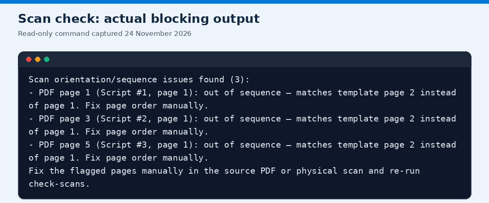

# Your first teacher-reviewed AI marking run on Azure

*Part 1 of 8 · For teachers · Evidence captured on 24 November 2026*


Marking software is useful only when you can see what it has done. In this series, we follow an existing handwritten exam through preparation, proposed marks, teacher review and reports. Every demonstrated stage includes an actual saved output or a fresh read-only check. We do not substitute a polished diagram for evidence that the application ran.

The application is [Azure Handwriting Grader Skills](https://github.com/wongcyrus/azure-handwriting-grader-skills). It uses Azure OpenAI for selected image and language tasks, with Microsoft Agent Framework coordinating the default grading workflow. Local Python code handles many other operations. AI does not approve scores or authorize email.

Our example is **four students, eight scanned pages, five questions and 50 possible marks**. Each student has two pages. It is an existing VTC-themed assessment, not the previously proposed six-student demonstration. The owner has confirmed that these example details may be retained for publication.

## What you will have at the end

You will understand how to check the exam structure, inspect the rubric and answer boxes, and recognize when to stop before spending money. The supplied saved reports demonstrate later stages; they do not prove that the current inputs pass every check today.

An IT colleague should first install the repository's locked dependencies and configure appropriate Azure deployments and authentication. Teachers should not need to paste credentials into an assistant conversation.

## Step 1: Look at the actual scanned exam

**Suggested teacher prompt**

```text
Use the existing example exam. Show me the first two scanned pages,
the number of scripts and the marking scheme.
Do not call Azure, approve anything or send email.
```


*Figure 1. Actual page 1 rendered from `example/VTC Test.pdf`, not a generated illustration.*

The page image is the starting evidence. Check that the entire answer area is visible, the handwriting is readable, and the page belongs to the expected layout. Do not judge crop quality from a small thumbnail; enlarge the original image.

**Output to inspect:** the scanned page. **Decision:** can the exam be read and divided into the intended two-page scripts? A filename alone cannot answer that question.

## Step 2: Run preflight—and understand what it proves

The following command was run read-only against the existing example:

```bash
handwriting-grader preflight --exam example/example.yaml
```

**Observed output**

```text
Preflight passed: 4 students, 0 absent, 8 pages, 2 pages per script.
Human confirmation of scan order and layout is still required.
```


*Figure 2. A rendered copy of real terminal output, not a product-interface screenshot.*

Preflight establishes basic structural consistency. Four expected students and eight pages fit a two-page-per-script configuration. It does not establish that each page is upright, correctly ordered or correctly associated with a student.

This distinction matters: a green structural check is not permission to stop looking.

## Step 3: Run the scan check—and stop at this example's blocker

```bash
handwriting-grader check-scans --exam example/example.yaml
```

**Observed output, shortened**

```text
Scan orientation/sequence issues found (3):
- PDF page 1 (Script #1, page 1): out of sequence
- PDF page 3 (Script #2, page 1): out of sequence
- PDF page 5 (Script #3, page 1): out of sequence
```

The full captured message says those pages match template page 2 instead of page 1 and asks for manual correction followed by another check. The command returned a nonzero exit status.



*Figure 3. Actual blocker captured while preparing this series.*

**Do not continue to paid grading from this state.** Compare the flagged pages with the configured layout. A detector can be wrong, so this is not proof that the paper pages are definitely shuffled. It is evidence that the current run is blocked and needs investigation. Do not silence the check or change approved inputs merely to obtain a successful screenshot.

The later articles inspect historical outputs that already exist. We did not rerun paid grading or claim to resolve this blocker during article preparation.

## Step 4: Inspect the saved rubric

The existing rubric workbook contains five questions worth ten marks each. Q1 asks students to expand VPET and explain its importance. Its item-specific allocation is 2 marks for the expansion, 4 for practical or specialized skills, and 4 for the workforce benefit.


*Figure 4. A table rendered from actual workbook cells; this is not an Excel screenshot.*

For a fresh run, the local spreadsheet import path is:

```bash
handwriting-grader import-rubric --exam /private/exam.yaml
```

This command is a procedure example, **not an execution transcript for this saved output**. The project also supports paid extraction from DOCX. Do not infer the original creation route from the presence of a workbook.

Inspect the question wording, partial-credit rules and maximum marks. Approve only after resolving ambiguities:

```bash
handwriting-grader approve-rubric --exam /private/exam.yaml \
  --confirm-reviewed
```

The flag records an explicit human action; it is not something the assistant should add on your behalf.

## Step 5: Inspect answer boxes before sending images

Fresh preparation and local review use:

```bash
handwriting-grader prepare-regions --exam /private/exam.yaml
handwriting-grader review-regions --exam /private/exam.yaml
```


*Figure 5. An offline visualization of saved annotations on the saved template—not a capture of the browser editor.*

Look for handwriting touching boundaries, labels associated with the wrong area, and identification fields that include printed headings. Part 4 shows why these checks are essential.

## Before the first paid request

Once blockers are resolved and the required input reviews are current, preview grading with your private priced configuration:

```bash
handwriting-grader grade --exam /private/exam.yaml \
  --model-config /private/priced-config.yaml \
  --endpoint https://YOUR-RESOURCE.openai.azure.com --api-version v1
```

This placeholder command has not been run as part of this article. Paid execution additionally requires explicit consent and `--confirm-cost`. The application verifies required prices before the paid request; a failed check must block rather than guess.

**The useful result of this first walkthrough is not “AI marked everything.”** It is a visible exam, a verified structural summary, a real scan blocker and reviewable rubric/crop evidence. Knowing when not to run AI is part of a successful workflow.

## Technical walkthrough: what the assistant and application actually do

There are two different kinds of prompt. The teacher's request tells the assistant
which reviewed workflow to invoke; it is not sent verbatim to the handwriting
model. The application constructs its own task-specific model prompt and attaches
the relevant document or image. A sentence such as "do not send email" is useful
operator intent, but the separate delivery commands and approvals enforce that
boundary in code.

### Why preflight is local, not an AI judgment

`cli.check_exam()` reads YAML, checks readable input paths, opens the roster with
`openpyxl`, checks unique IDs and required columns, and reads the PDF page count
with `PdfReader`. If attendance is supplied, it counts the present students.
Its structural comparison is this actual source excerpt:

```python
if roster_count and pdf_count is not None and pages and pdf_count != roster_count * pages:
    errors.append("PDF page count does not equal roster count times pages_per_student")
summary.update(exam=name, students=roster_count, absent=absent_count,
               pdf_pages=pdf_count, pages_per_student=pages)
return errors, summary
```

For the observed example, `4 * 2 == 8`, so this check passes. It cannot distinguish
two correctly ordered pages from two swapped pages. The separate scan checker
compares downsampled ink maps against expected page offsets and rotated
alternatives. In the captured command it uses majority-consensus references from
the PDF, not an AI opinion. This explains why the first command passes while the
second reports a blocker.

**Actual outputs:** the preflight summary and the three scan warnings shown above.
No model prompt is involved in either command.

### The complete optional DOCX-extraction prompt

If the source marking scheme is DOCX rather than a ready-made XLSX, the application
converts it to Markdown and supplies the following **complete production prompt**
from `rubric.PROMPT`. This is current source, not a recovered transcript proving
how the historical workbook was created:

```text
Extract the marking scheme from the document. Return every gradable
question or sub-question as its own separate entry with its exact label,
question text/context, marking criteria, and individual available marks.
Whenever a numbered question contains separately marked sub-parts, sub-items,
or fill-in-the-blank items (each having its own answer space or mark allocation),
split each sub-part into its own entry using its combined label rather than
collapsing multiple sub-parts into one parent entry. Include any general grading
guidance separately. Do not invent missing information.
```

The split-subparts instruction prevents one parent question from swallowing
several separately marked answer spaces. The "do not invent" instruction is not
the only safeguard: the response must also satisfy these source-defined models:

```python
class RubricQuestion(BaseModel):
    question_number: StrictStr
    question_text: StrictStr
    marking_scheme: StrictStr
    marks: float


class ExtractedRubric(BaseModel):
    general_grading_guide: StrictStr = ""
    questions: list[RubricQuestion]
```

`BaseModel` and `StrictStr` are Pydantic types. The application supplies the
document separately from the instruction:

```python
response = client.generate_content(
    model=model,
    contents=[PROMPT, content],
    config=GenerationConfig(**rubric_config),
)
```

Here `content` is the Markdown conversion, and `rubric_config` requests
`ExtractedRubric` structured output with a 16,384-token output limit. Python then
rejects missing question text, duplicate normalized question IDs, metadata labels
used as question IDs, and nonfinite or nonpositive marks. General guidance is
appended to each question's marking scheme so it reaches later grading prompts.
Source and model-config hashes are checked again before publishing the workbook.

**Actual output available:** the five-question workbook in Figure 4. **Not
captured:** a new DOCX request or its original raw JSON response. The XLSX import
path instead validates and copies a workbook without calling Azure.

### How a region becomes a crop

`prepare_regions()` renders the first script at 200 DPI, records each page's
dimensions and digest, and creates an empty annotation draft. A reviewed box is
stored in the page's pixel coordinates. The example Q3 box is 1191 pixels wide
and 254 pixels high; a label such as `Q3` is normalized to the rubric's question
key before lookup.

Later, `approved_inputs()` checks the rubric and region approvals and requires
the set of question boxes to equal the rubric's question set. Missing Q3 is an
error, not permission to omit that question. Part 4 shows the actual crop code,
optional region-suggestion prompt and coordinate conversion.

This separates four technical responsibilities: the assistant requests an
operation, Python validates its prerequisites, Azure proposes task-specific
content only where needed, and a teacher reviews the resulting artifacts.

Next: [review the existing proposed marks and reports](02-review-and-return.md).

<!-- BEGIN BANNER WALKTHROUGH -->
## Reproduce this article's AI banner: full prompt, code and output

The banner is a separate illustration task, not an image of a running grader or
evidence that an assessment succeeded. Its article title, description, visual
metaphor, palette and composition are all in the **complete actual submitted
prompt** below. No reference images or official logos were sent in this request.

### Stage A: the actual Azure image prompt

```text
Create a visually arresting premium editorial cover illustration for a Microsoft technical blog, not a slide, diagram or screenshot.

Article title: Your first teacher-reviewed AI marking run on Azure.
Description: Teachers prepare handwritten exams, inspect scans and answer regions, and see evidence at each step before allowing AI to draft marks. Human review remains essential; a failed check means stop, not automatic approval.

Creative concept: THE PAPER BRIDGE. A spectacular sculptural bridge made from folded ivory exam paper sweeps from the foreground toward a luminous blue gateway on the RIGHT side. Individual folded sheets gradually turn into tiny luminous geometric particles near the gateway. Warm amber light shines through the paper folds, against deep plum and midnight blue. Tactile paper fibers, cinematic volumetric light, elegant shallow depth of field and a strong sense of invitation. The gateway symbolizes beginning a carefully supervised workflow, not magical automatic grading.

Use one dominant, unmistakable hero silhouette. It should be beautiful and intriguing at thumbnail size. No ordinary desk still life, laptop, generic cloud icon, rows of cards or stock-photo classroom.

Composition: leave the LEFT 42 percent calm and dark plum for large typography added later. Put the bridge's main sculptural curve and blue gateway on the right. Compose all essential visual elements within the central horizontal band of a 1536x1024 canvas, approximately y=190 to y=830, so a wide 1200x515 crop works without cutting the hero. Avoid important objects near the top and bottom. Full-bleed artwork, no borders.

No rendered titles, letters, legible handwriting, numbers, logos, badges, watermarks, interfaces, score values or fabricated application outputs. Any paper marks are abstract strokes only. This is conceptual editorial art, not an observed grading result. Prioritize visual allure, rich light, contrast and a memorable composition over literal explanation.
```

This prompt's retained source is `branding/prompts/01.txt`. Asking for no
rendered words leaves typography to local code; the quiet side reserves space
for the headline. The image-size/crop instructions guide composition but do not
guarantee the model obeys every visual constraint, so the result was inspected.

### Stage B: preview and the real API boundary

Use the independent image-generation repository's own environment and a newly
reviewed private Azure configuration. The following command is an **offline
preview example**, not a paid request executed while rebuilding this article:

```bash
"/path/to/azure-image-generation-skills/.venv/bin/azure-image" \
  --model-config /private/image.config.yaml \
  --prompt-file "/path/to/azure-handwriting-grader-skills/docs/blog-series/branding/prompts/01.txt" \
  --output-dir /private/new-banner-part-01
```

Paid execution adds `--confirm-cost` only after explicit approval for one request.
The attempt directory must be new. Pricing is checked before SDK construction
and again at this actual source method from the independent tool:

```python
def generate(self, prompt):
    self.verifier.verify()
    return self.sdk.with_options(max_retries=0).images.generate(
        model=self.settings.model, prompt=prompt, size=IMAGE_SIZE,
        quality=IMAGE_QUALITY, n=1,
    )
```

`IMAGE_SIZE` is `1536x1024` and `IMAGE_QUALITY` is `auto`. `n=1` requests one
image; SDK and per-call retries are disabled. The SDK returns inline base64
image data. The tool decodes it, verifies PNG format and exact dimensions, saves
the original and keeps private usage/price journals. The published method
excerpt is from
[image-tool commit ee6c616](https://github.com/wongcyrus/azure-image-generation-skills/blob/ee6c616cdeac43a9c97b0261049cb278fd5449b5/src/azure_image_generation/client.py);
it is not a standalone script and is not installed as part of the grader.

**Observed output for this article:** one successful text-to-image request using
`gpt-image-2.5-sunburst`, with estimated cost **US$0.006655**.
This is historical usage evidence, not a guaranteed future quote or an invoice.


*Banner stage B output. A metadata-free JPEG publication derivative of the actual
1536 x 1024 generated PNG, before local typography and logos; not a fabricated
application screenshot.*

### Stage C: preserve the scene, then add exact words and retained brand assets

The publication builder creates a blurred background extension and fits the
complete generated scene without stretching it. Its relevant Pillow excerpt is:

```python
full_scene = ImageOps.contain(artwork, hero.size, Image.Resampling.LANCZOS)
hero.paste(full_scene, (x, 0), mask)
```

`hero` is the upper banner canvas, `x` anchors the scene opposite the headline,
and `mask` feathers the quiet edge into the background. The builder varies
left/right placement and light/dark text by article. `ImageDraw.text()` writes
the exact headline; the four retained brand assets are resized proportionally
and composited into a separate strip. AI is not asked to redraw those marks.

**Final output:** the [1200 x 630 PNG shown at the top](media/01-banner.png),
plus a 2400 x 1260 JPEG layout master. The larger master upscales layout and
artwork; it is not newly generated high-resolution detail. Original PNG and
submitted-prompt hashes are retained in `branding/artwork-provenance.json`.
[Local composition source](tools/banners.py) and
[brand-source/permission caveats](branding/README.md) are included.

Rebuilding Markdown/HTML, JPEG derivatives and banners is local work. It does
not regenerate artwork, refresh prices or authorize any new paid operation.
<!-- END BANNER WALKTHROUGH -->

**Implementation reference:** [installation and reviewed workflow at the inspected revision](https://github.com/wongcyrus/azure-handwriting-grader-skills/blob/b6af53dd1cf4cf74b9a50591f0e775a3b1533133/README.md).
