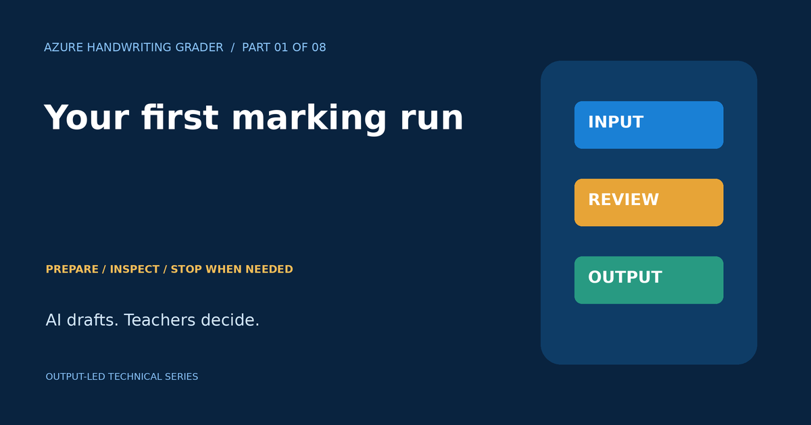
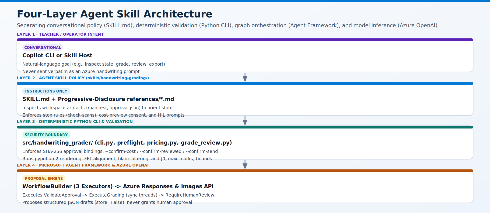
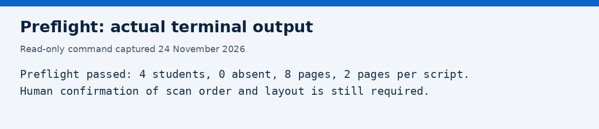
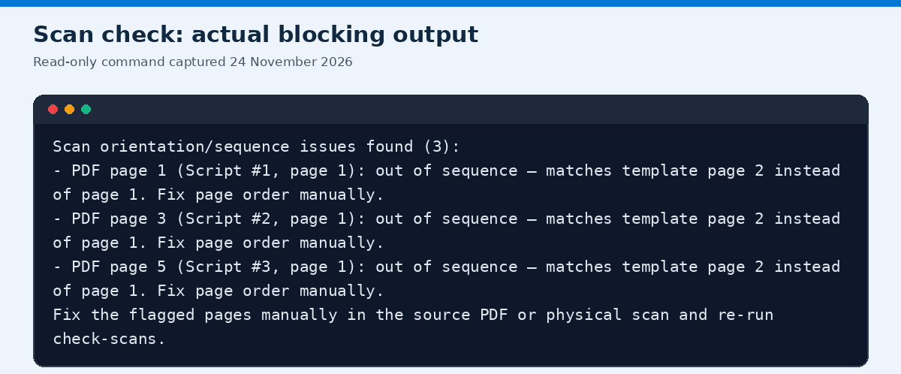
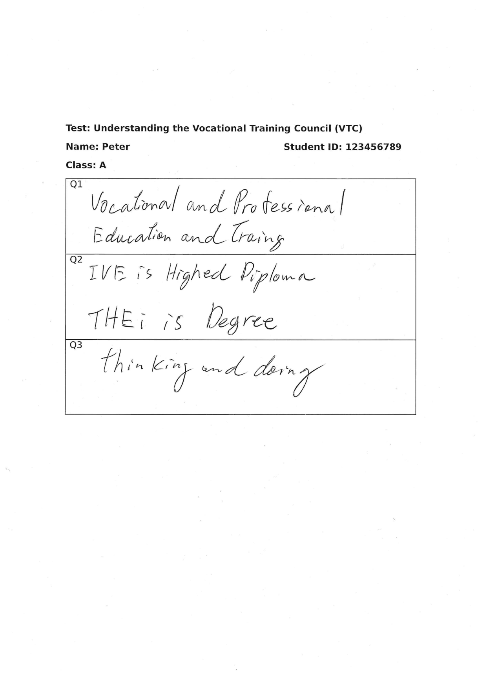
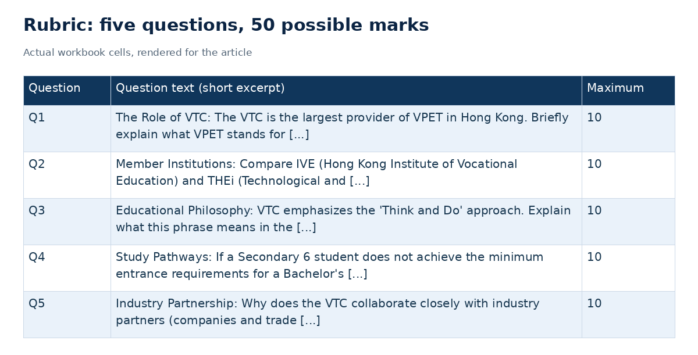
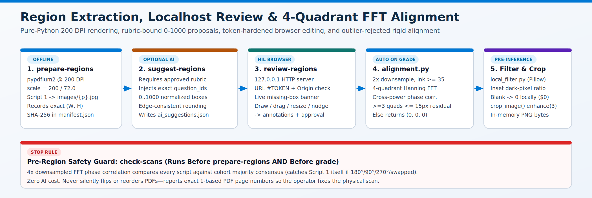
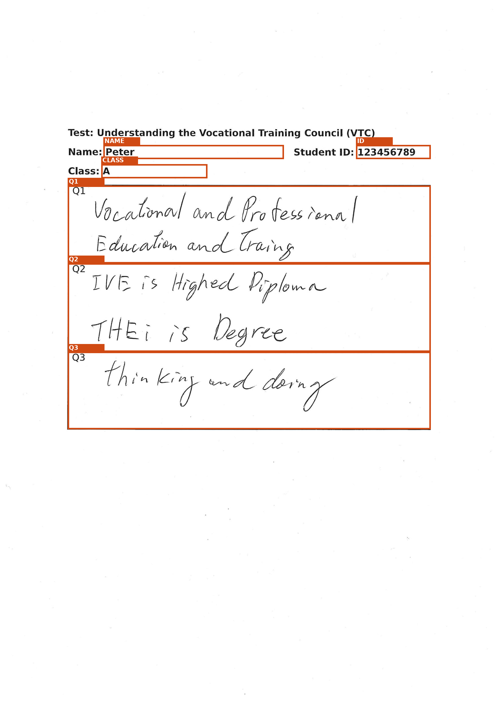
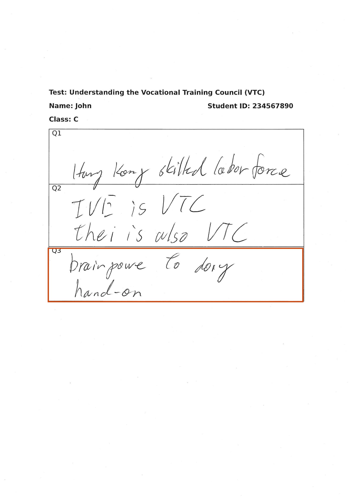
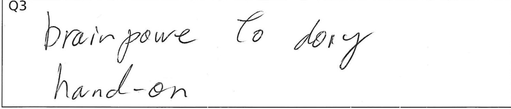

# Designing an Agent Skill for Exam Grading: Architecture, Preflight, and Computer Vision Pipeline

*Part 1 of 5 · MS MVP Technical Series · Agent Skills, Deterministic Preflight, Rubrics & Region Extraction*



## Introduction

Grading handwritten student examinations is one of the most time-consuming and high-stakes responsibilities in education. While multimodal large language models (LLMs) possess impressive visual recognition capabilities, deploying them directly in an academic grading workflow introduces severe risks: hallucinated criteria, inconsistent scoring rubrics, unpredictable token consumption, and accidental exposure of student data. The solution is not to surrender the process to autonomous AI loops, but to construct a **deterministic software harness** where AI operates under strict boundary conditions.

In this 5-part Microsoft MVP technical series, we dissect the architecture of [Azure Handwriting Grader Skills](https://github.com/wongcyrus/azure-handwriting-grader-skills)—an open-source, enterprise-grade system designed to grade handwritten exams with human-in-the-loop oversight on Azure OpenAI. The hardest engineering problem in real-world AI is rarely the model call itself; it is **where the AI stops and deterministic software takes over**.

In Part 1, we focus on the architectural foundation:
- **The Four-Layer Architecture**: Decoupling teacher intent in a conversational assistant, reusable **Agent Skill** policy in `.github/skills/handwriting-grading/SKILL.md`, deterministic Python command-line tooling, and **Microsoft Agent Framework** workflow orchestration.
- **Fail-Fast Preflight Validation**: Path jailing, student roster reconciliation, and strict multi-page scan verification before touching a model or spending a token.
- **Two-Pass Rubric Engineering**: Transforming unformatted teacher Word and Excel documents into structured JSON schemas with cross-criteria validation.
- **Computer Vision Region Pipeline**: Sub-millimeter bounding-box extraction, image resolution normalization, and coordinate anchoring for handwriting crops.



*Figure 1. Four-layer architecture separating conversational skill policy, deterministic Python validation, Agent Framework orchestration, and Azure OpenAI inference.*

## 1. Why an Agent Skill instead of a giant system prompt?

An **Agent Skill** is a portable, progressive-disclosure instruction package—not executable Python and not a security boundary. Its YAML frontmatter tells the host assistant *when* the skill applies:

```yaml
name: handwriting-grading
description: >-
  Guides preparation and human review of scanned handwriting grading with
  Azure OpenAI Handwriting Grader. Use for exam configuration, input validation,
  rubric and bounding-box review, grading review, reports, or safe planning
  of student-score distribution. Does not provide a general OCR service or
  authorize automated grading or email.
```

Instead of stuffing 1,500 lines of CLI flags and edge-case rules into every chat turn, `SKILL.md` uses **progressive disclosure**:
1. **Frontmatter**: Lightweight trigger metadata loaded at startup.
2. **State-oriented router**: A table mapping workspace artifacts (`exam.yaml`, `rubric/approval.json`, `regions/approval.json`, `grading/manifest.json`) to the next valid action.
3. **On-demand `references/*.md`**: Deep guides (`configuration.md`, `regions.md`, `grading.md`, `pricing.md`, `regrading.md`, `email.md`) read only when the user reaches that stage.

This excerpt from [SKILL.md](../../.github/skills/handwriting-grading/SKILL.md) defines how the assistant orients itself:

```markdown
Establish whether the user is starting or resuming, what stage they need,
and which local paths they intend to use. Do not copy or overwrite data.
```

To register the skill in Copilot CLI, an operator adds the `skills/` directory once (`copilot skill add "/path/to/azure-handwriting-grader-skills/skills"`) and verifies with `/skills list`. Cloning the repository alone does not load `skills/` automatically; the skill instructions also never replace Python's executable gates.

## 2. Stage 0 & 1: Answer sheets, path-jail preflight, and attendance

Before any scan is touched, the pipeline supports three deterministic preparation steps:

### Optional printable answer sheets (`answer-sheets`)
When a teacher has a roster and a DOCX template before the exam, `handwriting-grader answer-sheets --exam exam.yaml` merges student metadata into personalized DOCX files (including Word text boxes and hyperlinks) and converts them via local LibreOffice into numbered PDFs and a `combined.pdf` for printing. It runs against the **full roster**—independent of attendance—and leaves pagination verification to the teacher.

### Path-jail and structural preflight (`preflight`)
`handwriting-grader preflight --exam example/example.yaml` is strictly read-only and creates zero files. `cli.check_exam()` resolves every relative path from `exam.yaml`'s parent directory (`config_dir`) rather than the shell's current working directory, then enforces:
- **Path containment**: `output_dir` must not contain any input file (preventing accidental self-overwrite or cleanup deletion).
- **Roster integrity**: Opens the Excel sheet with `openpyxl`, preserves leading zeroes on `ID` strings, and rejects missing/duplicate IDs or missing `NAME`/`CLASS` columns.
- **Page-count parity**: Reads the scanned PDF with `pypdf` and checks `P = S × N`:

```python
if roster_count and pdf_count is not None and pages and pdf_count != roster_count * pages:
    errors.append("PDF page count does not equal roster count times pages_per_student")
summary.update(exam=name, students=roster_count, absent=absent_count,
               pdf_pages=pdf_count, pages_per_student=pages)
return errors, summary
```

**Observed output** on the cleared four-student, two-page-per-script VTC example:



*Figure 2. Real read-only preflight output. Four students × two pages = eight pages passes structural math, yet cannot prove page orientation.*

### Explicit attendance (`prepare-attendance` -> `approve-attendance`)
Absences are **never** inferred from missing PDF pages or blank OCR. If `attendance` is configured, the teacher supplies an explicit `ID,STATUS` CSV (`present`/`absent` for every roster ID), reviews `attendance/review.xlsx`, and runs `approve-attendance --confirm-reviewed` to bind the present-student set with SHA-256 hashes.

## 3. Why `check-scans` runs before region setup (4x FFT consensus)

A passing `preflight` cannot tell if Script 1 was fed into the scanner upside-down. If you draw bounding boxes on an upside-down Script 1, every downstream crop for the entire class will be wrong.

`handwriting-grader check-scans --exam example/example.yaml` solves this **offline at zero AI cost**. It renders pages via pure-Python `pypdfium2`, downsamples them 4x, and runs FFT phase correlation across the cohort to build a **majority-consensus reference** for each page position (`0..N-1`). Comparing every page against both upright and rotated (`90°`, `180°`, `270°`) consensus templates catches upside-down, sideways, blank, or swapped pages—even if Script 1 itself is the culprit.



*Figure 3. Actual `check-scans` blocker captured on `example/example.yaml`: PDF pages 1, 3, and 5 match template page 2.*

Because `check-scans` returned a non-zero exit code, `SKILL.md` enforces an explicit **stop rule**: report the exact 1-based PDF page numbers and script numbers so the teacher fixes the physical PDF manually—never silently flip or reorder pages in code.



*Figure 4. Actual page 1 rendered from `example/VTC Test.pdf` (150 DPI publication export) showing `NAME`, `ID`, `CLASS`, and Q1–Q3.*

## 4. Rubric ingestion: deterministic XLSX vs. structured DOCX extraction

Before regions can be suggested or grading can run, the system needs an approved rubric (`output/rubric/rubric.xlsx`). `SKILL.md` routes by source format:
- **Structured XLSX (`import-rubric`)**: Validates the `Marking Scheme` sheet locally (zero AI cost), rejecting formula cells, non-positive marks, and duplicate normalized `question_key()` IDs.
- **Unstructured DOCX (`extract-rubric --confirm-cost`)**: Converts the DOCX to Markdown via `mammoth` and calls Azure OpenAI with a Pydantic `ExtractedRubric` schema and `rubric.PROMPT`:

```text
Extract the marking scheme from the document. Return every gradable
question or sub-question as its own separate entry with its exact label,
question text/context, marking criteria, and individual available marks.
Whenever a numbered question contains separately marked sub-parts, sub-items,
or fill-in-the-blank items (each having its own answer space or mark allocation),
split each sub-part into its own entry using its combined label rather than
collapsing multiple sub-parts into one parent entry. Include any general grading
guidance separately. Do not invent missing information.
```

```python
class RubricQuestion(BaseModel):
    question_number: StrictStr
    question_text: StrictStr
    marking_scheme: StrictStr
    marks: float


class ExtractedRubric(BaseModel):
    general_grading_guide: StrictStr = ""
    questions: list[RubricQuestion]
```

```python
response = client.generate_content(
    model=model,
    contents=[PROMPT, content],
    config=GenerationConfig(**rubric_config),
)
```

Python then rejects missing text, duplicate normalized IDs, metadata labels (`NAME`/`ID`/`CLASS`) used as questions, and non-finite marks, appending `general_grading_guide` to each question's criteria. Optionally, `verify-rubric --confirm-cost` uses Azure Responses `web_search` (deliberately uncached) to produce `verification.xlsx` and `verification.docx` with cited sources for human fact-checking. Neither extraction nor verification approves the rubric—that requires `approve-rubric --confirm-reviewed`.



*Figure 5. Saved rubric workbook excerpt: five ten-mark questions totaling 50 marks.*

## 5. Region extraction, localhost review UI, and 4-quadrant FFT alignment

A multimodal LLM cannot grade handwriting that never entered the crop. As [SKILL.md](../../.github/skills/handwriting-grading/SKILL.md) makes clear, AI region suggestions are strictly optional—a local manual path is always available:

```markdown
Local manual region drawing remains available
without any paid suggestion. Every page still needs human review and approval.
```



*Figure 6. End-to-end region extraction pipeline: pure-Python `pypdfium2` rendering, optional `0..1000` AI proposals, token-hardened browser review, 4-quadrant FFT alignment, and Pillow blank filtering.*

### Pure-Python 200 DPI determinism (`prepare-regions`)
Historically, PDF-to-image pipelines relied on `pdftoppm` (Poppler), creating OS-specific installation friction across Windows, macOS, and Linux and subtle pixel-rounding differences. `prepare-regions` uses pure-Python `pypdfium2` at `200 DPI` (`scale = 200 / 72.0`), rendering Script 1's pages into `regions/images/{page}.jpg` and recording exact `(width, height)` dimensions (`1654 × 2338` in our example) and SHA-256 digests in `regions/manifest.json`. Later, Microsoft Agent Framework's `ValidateApproval` Executor verifies these approved region boxes before any grading call runs.

### Rubric-bound region extraction (`suggest-regions`)
If the teacher opts into AI region proposals (`suggest-regions --confirm-cost`), Python refuses to run until `rubric/approval.json` exists. `suggestions.build_prompt()` dynamically injects the **exact approved `question_number` list** and short question summaries into `suggestions.PROMPT` (and hashes `question_ids` into the opt-in cache key):

```text
Identify answer and metadata regions on this scanned exam page.

For metadata fields (NAME, ID, CLASS):
- The bounding box MUST enclose the handwritten/input value area (the blank line, box, or write-in space where the student writes), NOT the printed label text (such as "Name:", "Student ID:", or "Class:").
- For NAME: Allocate generous horizontal width across the entire designated answer line/blank to accommodate variable student name lengths.
- For ID and CLASS: Enclose the complete write-in area or box designated for the student's ID and class.
- Use exact labels "NAME", "ID", and "CLASS".

For question answer areas:
- Expected question IDs from the marking rubric: {question_ids}.
{question_details}- Return ONE bounding box enclosing the complete student answer area/table for each expected question ID that appears on this page.
- Use ONLY the exact question ID labels listed above. Do NOT invent, rename, or subdivide labels beyond that list.
- Do not include printed question instructions or titles in the answer box.

Coordinates must use a normalized 0-to-1000 scale: x and y are the top-left corner, and width and height are the box dimensions. Ensure all boxes lie entirely inside the page. Return an empty list if no regions can be identified.
```

Python converts normalized `0..1000` boxes to integer pixels at the edges (`right - left` rather than rounding `width` independently), retains `NAME`/`ID`/`CLASS` only on template page `0`, and rejects negative/out-of-bounds boxes before writing `ai_suggestions.json`:

```python
left = round(box.x * page["width"] / 1000)
top = round(box.y * page["height"] / 1000)
right = round((box.x + box.width) * page["width"] / 1000)
bottom = round((box.y + box.height) * page["height"] / 1000)
```



*Figure 7. Saved `1654 × 2338` template page with approved boxes (`NAME`, `ID`, `CLASS`, `Q1`–`Q3`).*

### Token-hardened localhost review UI (`review-regions`)
`handwriting-grader review-regions --exam exam.yaml` starts a zero-dependency local HTTP server (`editor.py`) bound to `127.0.0.1` with a random bearer token in the **URL fragment** (`#TOKEN`), strict **`Origin` header validation**, auto-loaded AI suggestions, zoom/pan, keyboard nudging, and a **live missing-box banner** verifying `ID` on page 0 plus every rubric question before "Approve all regions" writes `regions/approval.json`.

### Coordinate scale discipline & 4-quadrant FFT page alignment (`alignment.py`)
In our VTC example, John's Q3 box in `1654 × 2338` template space is `(222, 1153, 1191, 254)`:

```json
{
  "x": 222,
  "y": 1153,
  "width": 1191,
  "height": 254,
  "label": "Q3"
}
```

When overlaying boxes onto a 150-DPI publication export (`1241 × 1754`), you must scale X and Y independently:

```python
sx = display_width / original_width
sy = display_height / original_height
display_box = (
    round(x * sx),
    round(y * sy),
    round((x + width) * sx),
    round((y + height) * sy),
)
```



*Figure 8. John's saved grading page (script index 2) with the Q3 boundary highlighted.*



*Figure 9. Reconstructed Q3 crop (`1191 × 254` px) showing a second line ("hand-on") that the historical transcription missed.*

To compensate for physical scanner drift during `grade` (and `retry-grading --align-images`, which re-renders from the original PDF into `grading/alignment-history/recovery-*/`), `alignment.py` downsamples 2x, thresholds ink (`255 - pixel >= 35`), applies a **Hanning window** to each quadrant, and computes normalized **FFT cross-power phase correlation**:

```python
fa = np.fft.rfft2(ref_patch * win)
fb = np.fft.rfft2(cur_patch * win)
cross_power = fa * np.conj(fb)
cross_power /= np.maximum(np.abs(cross_power), 1e-8)
cc = np.fft.irfft2(cross_power, s=ref_patch.shape)
```

It fits a rigid transform (`tx, ty, theta`, bounded to `±150 px` and `±5°`) and **rejects outliers**—requiring at least three positively weighted quadrants to agree within `15.0` full-resolution pixels:

```python
residuals = np.hypot(
    dx - (tx - theta * py),
    dy - (ty + theta * px),
)
if np.count_nonzero((weights > 0.0) & (residuals <= 15.0)) < 3:
    return 0.0, 0.0, 0.0
```

Finally, before calling Azure OpenAI, `local_filter.py` runs an inset Pillow dark-pixel check (`ink_threshold=160`, `max_ink_ratio=0.0015`) to assign `0` locally to clearly blank answers, and `grading.crop_image()` sharpens non-blank crops in memory:

```python
def crop_image(path, box):
    with Image.open(path) as image:
        x, y = box["x"], box["y"]
        crop = image.crop((x, y, x + box["width"], y + box["height"]))
        crop = ImageEnhance.Sharpness(crop).enhance(3)
        buffer = io.BytesIO()
        crop.save(buffer, format="PNG")
        return buffer.getvalue()
```

Next: [Multi-Role Azure OpenAI & Microsoft Agent Framework: Orchestration Without Surrendering Control](02-multimodal-grading-and-agent-framework.md).

**Implementation references:** [preflight and CLI](https://github.com/wongcyrus/azure-handwriting-grader-skills/blob/b6af53dd1cf4cf74b9a50591f0e775a3b1533133/src/handwriting_grader/cli.py), [rubric extraction](https://github.com/wongcyrus/azure-handwriting-grader-skills/blob/b6af53dd1cf4cf74b9a50591f0e775a3b1533133/src/handwriting_grader/rubric.py), [region suggestions](https://github.com/wongcyrus/azure-handwriting-grader-skills/blob/b6af53dd1cf4cf74b9a50591f0e775a3b1533133/src/handwriting_grader/suggestions.py), and [FFT alignment](https://github.com/wongcyrus/azure-handwriting-grader-skills/blob/b6af53dd1cf4cf74b9a50591f0e775a3b1533133/src/handwriting_grader/alignment.py).
