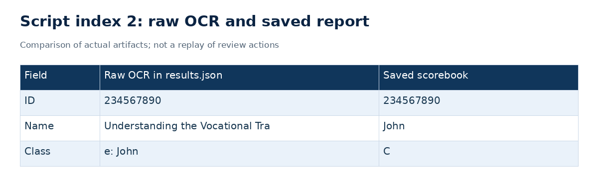

# Review, correct and return results—with the teacher in control

*Part 2 of 8 · For teachers · Saved outputs, not a new grading run*


A complete spreadsheet is not the same as a trustworthy assessment. This article follows the existing example from OCR identities and draft marks to saved reports. The most useful evidence is not the highest score: it is a misread identity and an answer flagged as cut off.

The example's current scan check is blocked, as shown in [Part 1](01-first-marking-run.md). We inspect existing artifacts without claiming that the current source can be graded again unchanged. No scores, approvals or files in the original run were modified to write this article.

## Step 1: Compare OCR identity with reviewed identity

**Suggested teacher prompt**

```text
Show each script's OCR identity beside the reviewed student identity.
Highlight disagreements. Do not approve results or send anything.
```

The raw `results.json` contains this metadata for zero-based script index 2
(selected fields; the ID is visible in the cleared comparison figure below):

```json
{
  "script_index": 2,
  "class_ocr": "e: John",
  "name_ocr": "Understanding the Vocational Tra"
}
```

Those strings are observed OCR output, not a deliberately invented failure. The saved scorebook identifies the corresponding student as **John, class C**.



*Figure 1. A comparison assembled from actual JSON and workbook cells, not a before/after browser screenshot.*

The correct ID helped here, but it does not make the name and class fields reliable. Check the original page and roster. Preserve leading zeroes in IDs and verify that each PDF belongs to the intended student.

The saved artifacts show the raw/reported difference. They do not prove the exact sequence of mouse clicks that produced the reviewed result.

## Step 2: Inspect the answer, not only the proposed mark

The saved result for John's Q3 includes:

```json
{
  "question": "Q3",
  "answer": "brain powe[r] to doing [continuation cut off]",
  "raw_mark": 2.0,
  "moderated_mark": 2.0,
  "moderator_flag": true,
  "moderator_note": "The answer continues beyond the bottom of the image. Verify the full response and the partially legible wording."
}
```


*Figure 2. Crop reconstructed from the saved grading image and saved Q3 coordinates. It illustrates the saved crop boundary; it is not proof of the exact encoded payload of a historical request.*

The teacher's next question should be “What is outside that box?” rather than “Is two a plausible number?” Open the full page, inspect the continuation, and decide whether a manual correction or separately approved regrade is appropriate.

A warning does not solve the underlying problem. Nor does `grading_failed: false` establish that the answer is complete.

The reconstructed crop now visibly includes a second line resembling “hand-on,” while the stored transcription says the continuation was cut off. These saved artifacts are not a packet capture of the original request. Preserve that discrepancy: it is a reason to compare historical inputs and recovery history, not to assert that the current crop exactly reproduces what the model saw.

## Step 3: Read the review workbook

Open the local review interface for your intended run:

```bash
handwriting-grader review-grading --exam /private/exam.yaml
```

Do not publish its token-bearing URL. This article uses workbook-derived images instead of opening a live review session.

The saved `Marks` sheet records Q3 for script index 2 with raw mark 2, manual mark 2 and `reviewed = yes`. Q1, Q2 and Q5 for that script also contain flags and explicit manual marks.


*Figure 3. Actual workbook values. A manual mark equal to the proposal is still an explicit recorded choice; it is not a score change.*

This matters when describing “human correction.” The evidence supports a reviewed identity difference and explicit manual marks. It does not support a claim that the teacher changed every flagged score or recovered all clipped text.

## Step 4: Run read-only discrepancy checks

We ran:

```bash
handwriting-grader check-grading-review --exam example/example.yaml
```

**Observed output**

```text
No review discrepancies found. Human review and explicit approval are still required.
```

This is a consistency check, not a pedagogical endorsement. It does not cancel the separate scan-check warning, establish current downstream approval validity, or prove that every grade is correct.

For a fresh run, approval follows actual human review:

```bash
handwriting-grader approve-grading --exam /private/exam.yaml \
  --confirm-reviewed
```

We did not run that approval command for this article.

## Step 5: Inspect the actual marked PDF and scorebook

The existing report is a version-1 artifact. It contains four students with these saved totals:

| Student | Class | Total / 50 |
|---|---|---|
| Peter | A | 23 |
| Mary | B | 10 |
| John | C | 10 |
| Susan | D | 10 |


*Figure 4. PDF-to-PNG rendering of the existing marked script.*


*Figure 5. Data rendered directly from the saved `score_report.xlsx`.*

A fresh, approved run produces reports with:

```bash
handwriting-grader report --exam /private/exam.yaml
```

Existing report directories are not an invitation to overwrite history. The saved report's filenames are still `pdfs/script-00001.pdf` and similar. Newer code produces names such as `123456789_Peter_script-00001.pdf`, using approved identity and roster name. **The historical output has not been renamed.** A new naming rule is not evidence that an old PDF already has that name.

## Step 6: Separate reporting from distribution

Generating a PDF does not send it. Moodle export uses the `moodle-export` command; email requires a recipient/settings preview, separate review and explicit send consent.

```bash
handwriting-grader preview-email --exam /private/exam.yaml \
  --settings /private/email.yaml --recipients /private/recipients.csv
```

This is a command example only. **No delivery preview, Moodle export or email-send output was captured for this series.** Do not label the marked PDF as evidence of delivery.

The observable end state here is four saved totals, marked pages, identity-review evidence and explicit manual-review fields. For teachers, that evidence trail is more informative than a claim that marking was “fully automated.”

Next: [the application logic behind these boundaries](03-logic-and-recovery.md).

**Implementation references:** [grading review](https://github.com/wongcyrus/azure-handwriting-grader-skills/blob/b6af53dd1cf4cf74b9a50591f0e775a3b1533133/src/handwriting_grader/grade_review.py) and [report naming](https://github.com/wongcyrus/azure-handwriting-grader-skills/blob/b6af53dd1cf4cf74b9a50591f0e775a3b1533133/src/handwriting_grader/reporting.py).
