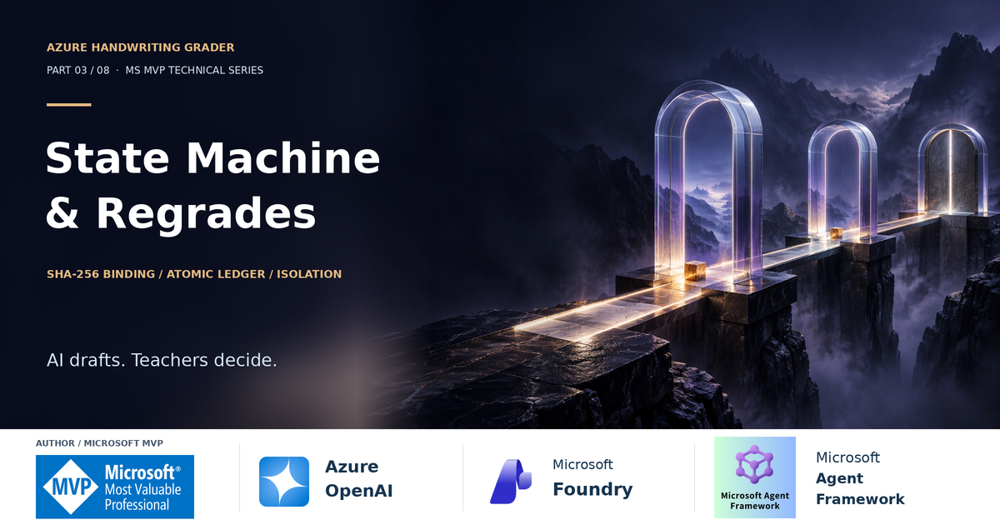
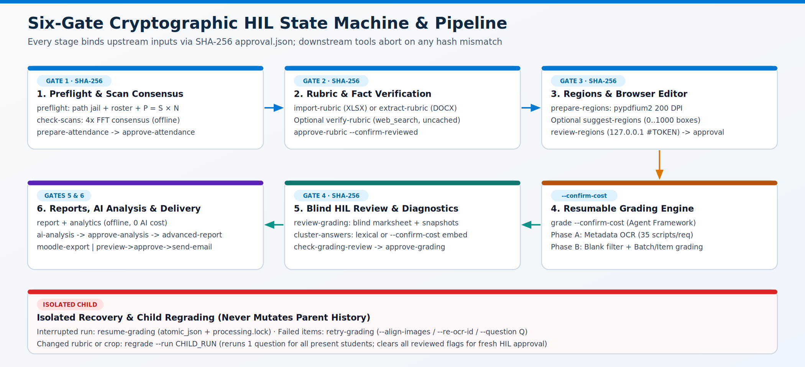
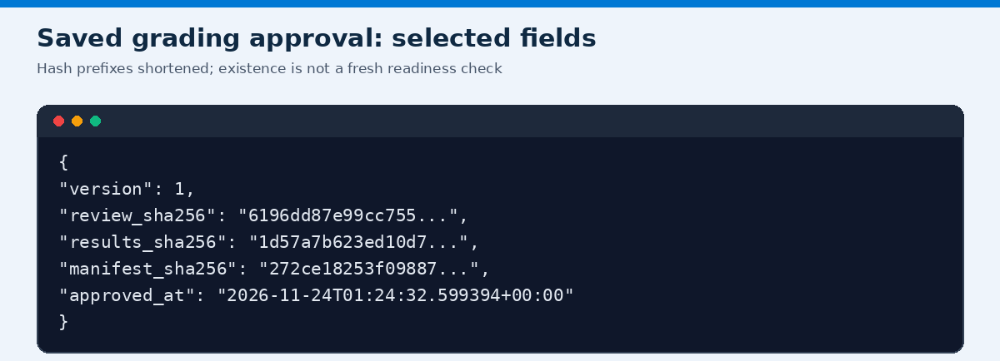

# Logic before AI: approvals, checkpoints and recovery

*Part 3 of 8 · For developers · Source walkthrough with saved artifact evidence*



The most important architecture decision in this grader is not a model name. It is that model output cannot promote itself into an approved result.

In [Part 2](02-review-and-return.md), OCR read John's class as `e: John` and his name as part of a printed heading. The saved report nevertheless associates his ID with John in class C. That separation between raw output and reviewed output must exist in the application logic, not only in a prompt.

This article explains the boundaries using actual artifact structures and source excerpts. It does not pretend that every recovery path has been exercised against this saved exam.

## Step 1: Make dependencies explicit

Inputs include the exam configuration, scans, roster, rubric and region definitions. The pipeline does not simply ask whether their files exist. It checks whether the appropriate approvals still match the relevant artifacts.



*Figure 1. Code-authored explanatory diagram, not a runtime trace. Editable source is included in `diagrams/architecture.mmd`.*

The actual `approved_inputs()` starts with these calls:

```python
approved_attendance(config, config_dir, config_path)
questions = read_approved_rubric(config, config_dir, config_path)
root, manifest = verify_run(config, config_dir, config_path)
```

It then loads the region draft, checks current region approval, validates complete annotations, and compares available question labels with the rubric.

**Expected output of this boundary:** either validated inputs for the next stage or an exception. This is a source contract, not a newly captured exception transcript. Part 1 supplies a real stopping case from the separate scan checker.

## Step 2: Inspect what the saved approvals bind

The saved grading approval contains these keys:

```text
version
review_sha256
results_sha256
manifest_sha256
approved_at
```



*Figure 2. Selected fields from a real local approval artifact. Hash prefixes are shortened for presentation.*

The source in `grade_review.py` checks:

```python
if (
    approval.get("version") != 1
    or approval.get("review_sha256") != file_hash(root / "review.xlsx")
    or approval.get("results_sha256") != file_hash(root / "results.json")
    or approval.get("manifest_sha256") != file_hash(root / "manifest.json")
):
    raise ValueError("Grading review changed since approval")
```

This excerpt demonstrates how a change is detected. It does not establish that every historical artifact is currently valid. The current example also has a scan-check blocker, so the mere existence of `approval.json` is not a fresh readiness certificate.

Hashes support local consistency checks. They do not make a directory tamper-proof against someone able to rewrite both files and approval records.

## Step 3: Keep raw, reviewed and reported values distinct

The saved run gives us three useful views:

| Artifact | Role | Actual example |
|---|---|---|
| `grading/results.json` | Raw inference/checkpoint data | Cut-off Q3 transcription and moderator note |
| `grading/review.xlsx` | Teacher review fields | Explicit manual mark 2 and `reviewed = yes` |
| `reports/score_report.xlsx` | Saved report output | John, class C, total 10 |

A developer should resist flattening these into one mutable record. Otherwise a manual edit can erase what the model originally proposed, making later diagnosis difficult.

**Suggested operator prompt**

```text
Explain the differences between raw results, review fields and reports.
Show the affected script and question keys.
Do not replace raw model results or record approval for me.
```

**Output to expect:** a comparison keyed by script/question, not a silent rewrite. The figures in Part 2 provide the actual comparison for this exam.

## Step 4: Use checkpoints without promising exactly-once billing

The saved `results.json` records:

```json
{
  "version": 1,
  "checkpoint_version": 1,
  "completed": true
}
```

The completed run contains four script metadata records and 20 question-mark records. These counts describe the saved checkpoint; they do not mean 20 billable API requests.

The application uses atomic checkpoint publication and a run lock to avoid conflicting writers. On a suitable interrupted run, an operator previews:

```bash
handwriting-grader resume-grading --exam /private/exam.yaml
```

New paid work still needs fresh consent. A request accepted by Azure just before a crash may not be checkpointed locally. Resumption can repeat that request and incur a second charge. “Resumable” therefore means preserving recorded work—not exactly-once provider execution.

Do not run resume against a completed run simply to obtain a screenshot. Do not delete a live lock.

## Step 5: Choose retry or child regrade deliberately

A completed run with failed work uses `retry-grading`; a revised rubric or crop can require an isolated child regrade.

```bash
handwriting-grader regrade --exam /private/exam.yaml \
  --run q3-review-1 --question Q3 \
  --model-config /private/priced-config.yaml \
  --endpoint https://YOUR-RESOURCE.openai.azure.com --api-version v1
```

This is a preview example, not a run we performed. A crop/rubric change requires its separately reviewed proposal. The selected question is rerun for **all present students**, not just one student's chosen answer. The child has its own output directory and requires review of all identities and scores.

**Output not captured:** there is no child-run comparison image in this package. The saved flagged answer motivates the workflow, but it is not evidence that a corrected child run exists.

## What this design buys you—and what it does not

It gives operators inspectable artifacts, explicit state transitions and opportunities to stop. It does not establish that a rubric is fair, a crop is complete or an approved score is educationally correct.

The actual scan blocker and OCR failures show why these boundaries matter. A system that can explain why it stopped is more useful than one that turns every failure into an apparently complete report.

## Technical walkthrough: state transitions, not approval by prompt

An operator can ask the assistant to resume safely:

```text
Inspect the run manifest and checkpoint first.
Explain which script/question pairs are missing and which inputs are bound by hashes.
Preview resume or an isolated child regrade, as appropriate.
Do not remove a lock, replace an approval, alter raw results or make a paid request.
```

This is an operator prompt, not an Azure model prompt. The following Python
mechanisms enforce the important parts even if an operator request is vague.

### The prerequisite gate returns a concrete crop map

The first half of `approved_inputs()` validates attendance, reads the approved
rubric and checks the region run. Its second half is:

```python
if not approval_is_current(root, manifest, draft):
    raise ValueError("Current region review has not been approved")
annotations = draft["annotations"]
validate_annotations(annotations, manifest["pages"], complete=True)
boxes = {}
for page, page_boxes in annotations.items():
    for box in page_boxes:
        boxes[question_key(box["label"])] = (int(page), box)
expected = {question_key(q["question_number"]) for q in questions}
actual = set(boxes) - {"NAME", "ID", "CLASS"}
if actual != expected:
    raise ValueError("Approved region labels do not match the approved rubric")
return questions, root, manifest, boxes
```

The returned map relates a normalized question key to a page offset and pixel
box. This is why a changed rubric or missing answer box must be resolved before
inference, not interpreted as a model's blank answer.

### A checkpoint is a keyed ledger, not a count of API calls

`continue_grading()` reconstructs dictionaries from saved records:

```python
scripts = {row["script_index"]: row for row in results["scripts"]}
marks = {(row["script_index"], question_key(row["question"])): row for row in results["marks"]}
missing_scripts = [si for si in range(summary["students"]) if si not in scripts]
```

It rejects duplicates and unexpected keys before continuing. Batch workers
publish records keyed by `(script_index, question_key)` under a result lock.
Completion requires four metadata records, all twenty student/question pairs,
and coverage of every moderated question in this example. The engine also checks
model configuration, roster, rubric and region-approval hashes before setting
`completed = true`. Completion means a full ledger exists; human review is a
later state transition.

### How atomic JSON publication works

The exact publication core in `regions.atomic_json()` is:

```python
with tempfile.NamedTemporaryFile(
    mode="w", encoding="utf-8", dir=path.parent, delete=False
) as file:
    temp = Path(file.name)
    try:
        json.dump(value, file, ensure_ascii=False, indent=2)
        file.write("\n")
        file.flush()
        os.fsync(file.fileno())
    except BaseException:
        temp.unlink(missing_ok=True)
        raise
try:
    os.replace(temp, path)
finally:
    temp.unlink(missing_ok=True)
```

The caller has already converted `path` to a `Path`. A temporary file in the same
directory is flushed before `os.replace()` publishes the new name, so a reader
does not see half-written JSON. This is not a transaction spanning Azure,
`results.json`, the review workbook and every directory entry. In particular,
a provider response can be billed before its record is published locally.

### Why the processing lock is separate

The source uses exclusive file creation, not "check then create":

```python
lock = target / "processing.lock"
try:
    with lock.open("x", encoding="utf-8") as file:
        file.write("Grading in progress; inspect stale locks before removing.\n")
except FileExistsError as exc:
    raise ValueError("Another grading process or a stale lock exists") from exc
```

The surrounding context manager removes its lock on exit. A terminated process
can leave a stale lock, which needs investigation rather than automatic deletion.
Atomic JSON prevents partial records; the run lock prevents two writers from
independently advancing the same checkpoint. They solve different problems.

### What changes when an input changes

Resume uses the original run's bound inputs and missing-record ledger. A changed
question rubric or crop belongs to a separately reviewed proposal and child run,
with fresh review afterwards. Copying an old approval into a child folder would
not make its digests match. Neither path provides exactly-once provider billing:
the application can know which results were recorded, not whether a request
accepted just before a crash was charged.

**Observed evidence remains:** the completed four-script/twenty-mark checkpoint
and saved approval fields above. No interrupted-run, stale-lock deletion or child
regrade was performed to illustrate these source contracts.

Next: [inspect the images and alignment logic](04-scans-crops-alignment.md).

<!-- BEGIN BANNER WALKTHROUGH -->
## Reproduce this article's AI banner: full prompt, code and output

The banner is a separate illustration task, not an image of a running grader or
evidence that an assessment succeeded. Its article title, description, visual
metaphor, palette and composition are all in the **complete actual submitted
prompt** below. No reference images or official logos were sent in this request.

### Stage A: the actual Azure image prompt

```text
Create a visually arresting premium editorial cover illustration for a Microsoft technical blog, not a slide, diagram or screenshot.

Article title: Logic before AI: approvals, checkpoints and recovery.
Description: Application logic validates approved inputs, separates drafts from approved results, records checkpoints and permits conservative recovery. AI output cannot promote itself into an approved result.

Creative concept: THE ARCHITECTURE OF TRUST. On the RIGHT, a monumental miniature architectural sculpture: a graceful illuminated path passes through three tall transparent glass gates, separated by deep gaps bridged by precise narrow walkways. Small solid amber checkpoint stones sit at the gate thresholds. One final gate is visibly closed, creating a beautiful visual boundary rather than an implication of unrestricted autonomy. Obsidian ground, frosted violet glass, cool white luminous edges and a restrained amber accent. Dramatic architectural lighting, deep indigo atmosphere and a premium museum-installation aesthetic.

This is a striking sculptural metaphor, not a labeled flowchart. No paper desk, laptops, robot mascot, hexagon swarm or generic cybersecurity padlock. The geometry must feel intentional, precise and beautiful.

Composition: leave the LEFT 42 percent dark and visually quiet for large typography added later. Gates and bridges occupy the right with a strong diagonal rhythm. Keep the gate tops and path inside the central horizontal band of a 1536x1024 canvas, approximately y=190 to y=830, for a wide 1200x515 crop. Full-bleed, no borders.

No titles, letters, numbers, logos, badges, watermarks, UI panels or fabricated runtime evidence. This is conceptual editorial art rather than a reconstruction of an actual execution. Prioritize memorable architecture, restrained luxury, contrast and light.
```

This prompt's retained source is `branding/prompts/03.txt`. Asking for no
rendered words leaves typography to local code; the quiet side reserves space
for the headline. The image-size/crop instructions guide composition but do not
guarantee the model obeys every visual constraint, so the result was inspected.

### Stage B: preview and the real API boundary

Use the independent image-generation repository's own environment and a newly
reviewed private Azure configuration. The following command is an **offline
preview example**, not a paid request executed while rebuilding this article:

```bash
"/path/to/azure-image-generation-skills/.venv/bin/azure-image" \
  --model-config /private/image.config.yaml \
  --prompt-file "/path/to/azure-handwriting-grader-skills/docs/blog-series/branding/prompts/03.txt" \
  --output-dir /private/new-banner-part-03
```

Paid execution adds `--confirm-cost` only after explicit approval for one request.
The attempt directory must be new. Pricing is checked before SDK construction
and again at this actual source method from the independent tool:

```python
def generate(self, prompt):
    self.verifier.verify()
    return self.sdk.with_options(max_retries=0).images.generate(
        model=self.settings.model, prompt=prompt, size=IMAGE_SIZE,
        quality=IMAGE_QUALITY, n=1,
    )
```

`IMAGE_SIZE` is `1536x1024` and `IMAGE_QUALITY` is `auto`. `n=1` requests one
image; SDK and per-call retries are disabled. The SDK returns inline base64
image data. The tool decodes it, verifies PNG format and exact dimensions, saves
the original and keeps private usage/price journals. The published method
excerpt is from
[image-tool commit ee6c616](https://github.com/wongcyrus/azure-image-generation-skills/blob/ee6c616cdeac43a9c97b0261049cb278fd5449b5/src/azure_image_generation/client.py);
it is not a standalone script and is not installed as part of the grader.

**Observed output for this article:** one successful text-to-image request using
`gpt-image-2.5-sunburst`, with estimated cost **US$0.006505**.
This is historical usage evidence, not a guaranteed future quote or an invoice.


*Banner stage B output. A metadata-free JPEG publication derivative of the actual
1536 x 1024 generated PNG, before local typography and logos; not a fabricated
application screenshot.*

### Stage C: preserve the scene, then add exact words and retained brand assets

The publication builder creates a blurred background extension and fits the
complete generated scene without stretching it. Its relevant Pillow excerpt is:

```python
full_scene = ImageOps.contain(artwork, hero.size, Image.Resampling.LANCZOS)
hero.paste(full_scene, (x, 0), mask)
```

`hero` is the upper banner canvas, `x` anchors the scene opposite the headline,
and `mask` feathers the quiet edge into the background. The builder varies
left/right placement and light/dark text by article. `ImageDraw.text()` writes
the exact headline; the four retained brand assets are resized proportionally
and composited into a separate strip. AI is not asked to redraw those marks.

**Final output:** the [1200 x 630 PNG shown at the top](media/03-banner.png),
plus a 2400 x 1260 JPEG layout master. The larger master upscales layout and
artwork; it is not newly generated high-resolution detail. Original PNG and
submitted-prompt hashes are retained in `branding/artwork-provenance.json`.
[Local composition source](tools/banners.py) and
[brand-source/permission caveats](branding/README.md) are included.

Rebuilding Markdown/HTML, JPEG derivatives and banners is local work. It does
not regenerate artwork, refresh prices or authorize any new paid operation.
<!-- END BANNER WALKTHROUGH -->

**Implementation references:** [approval validation](https://github.com/wongcyrus/azure-handwriting-grader-skills/blob/b6af53dd1cf4cf74b9a50591f0e775a3b1533133/src/handwriting_grader/grade_review.py) and [targeted regrading](https://github.com/wongcyrus/azure-handwriting-grader-skills/blob/b6af53dd1cf4cf74b9a50591f0e775a3b1533133/skills/handwriting-grading/references/regrading.md).
