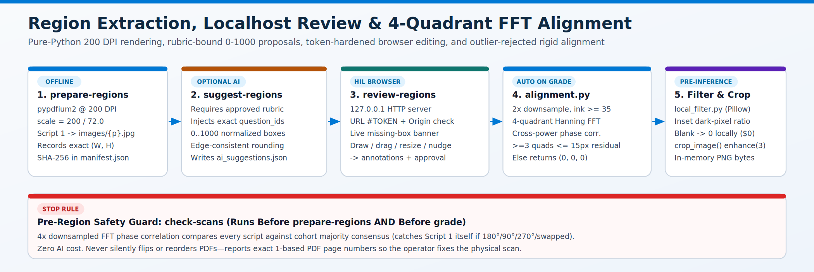
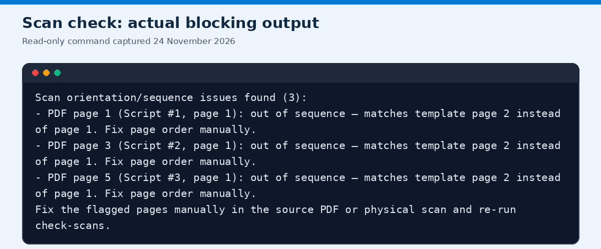
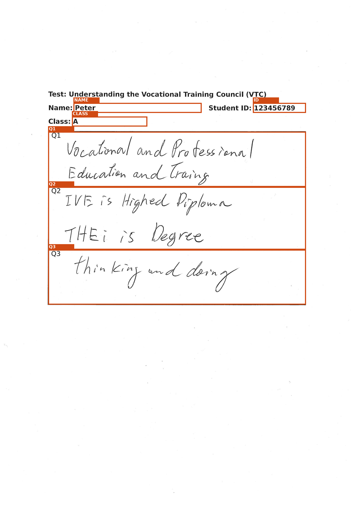
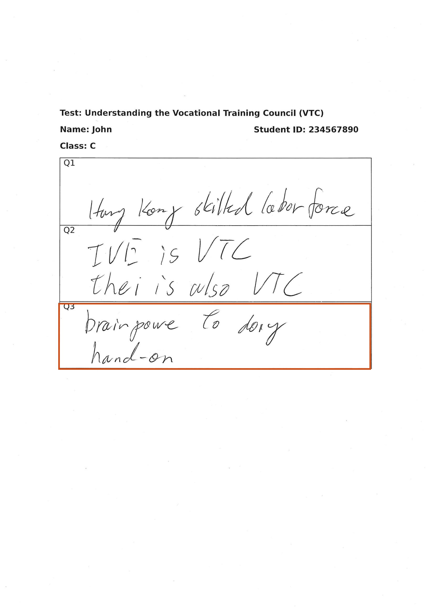
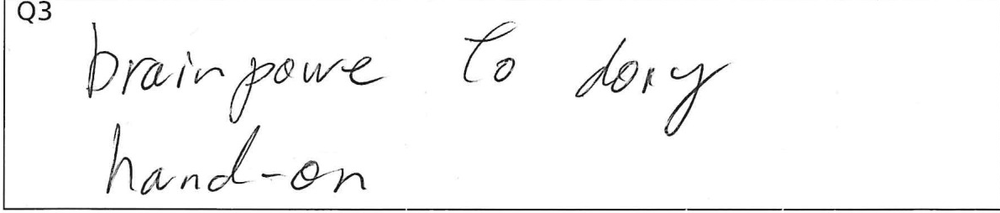

# Region Extraction, Localhost Review UI, and FFT Page Alignment

*Part 4 of 8 · MS MVP Technical Series · Computer Vision & Region Pipeline*


A multimodal LLM cannot grade handwriting that never entered the crop. Before blaming a model for a low mark or misread ID, an engineer has to get four things right: **deterministic rendering**, **rubric-bound region extraction**, **human-verified pixel coordinates**, and **rigid scanner alignment**.

As [SKILL.md](../../skills/handwriting-grading/SKILL.md) makes clear, AI region suggestions are strictly optional—a local manual path is always available:

```markdown
Local manual region drawing remains available
without any paid suggestion. Every page still needs human review and approval.
```



*Figure 1. End-to-end region extraction pipeline: pure-Python `pypdfium2` rendering, optional `0..1000` AI proposals, token-hardened browser review, 4-quadrant FFT alignment, and Pillow blank filtering.*

## 1. Pure-Python 200 DPI determinism (`prepare-regions`)

Historically, PDF-to-image pipelines relied on `pdftoppm` (Poppler), creating OS-specific installation friction across Windows, macOS, and Linux and subtle pixel-rounding differences. `prepare-regions` uses pure-Python `pypdfium2` at `200 DPI` (`scale = 200 / 72.0`), rendering Script 1's pages into `regions/images/{page}.jpg` and recording exact `(width, height)` dimensions (`1654 × 2338` in our example) and SHA-256 digests in `regions/manifest.json`.

Before running `prepare-regions`, the operator runs `check-scans` (covered in Part 1) so an upside-down Script 1 never corrupts the template layout for the whole cohort. Later, Microsoft Agent Framework's `ValidateApproval` Executor verifies these approved region boxes before any grading call runs.



*Figure 2. Real read-only `check-scans` output. A rigid alignment transform cannot fix a swapped page.*

## 2. Rubric-bound region extraction (`suggest-regions`)

If the teacher opts into AI region proposals (`suggest-regions --confirm-cost`), Python refuses to run until `rubric/approval.json` exists. Why? Because `suggestions.build_prompt()` dynamically injects the **exact approved `question_number` list** and short question summaries into `suggestions.PROMPT` (and hashes `question_ids` into the opt-in cache key):

```text
Identify answer and metadata regions on this scanned exam page.

For metadata fields (NAME, ID, CLASS):
- The bounding box MUST enclose the handwritten/input value area (the blank line, box, or write-in space where the student writes), NOT the printed label text (such as "Name:", "Student ID:", or "Class:").
- For NAME: Allocate generous horizontal width across the entire designated answer line/blank to accommodate variable student name lengths.
- For ID and CLASS: Enclose the complete write-in area or box designated for the student's ID and class.
- Use exact labels "NAME", "ID", and "CLASS".

For question answer areas:
- Expected question IDs from the marking rubric: {question_ids}.
{question_details}- Return ONE bounding box enclosing the complete student answer area/table for each expected question ID that appears on this page.
- Use ONLY the exact question ID labels listed above. Do NOT invent, rename, or subdivide labels beyond that list.
- Do not include printed question instructions or titles in the answer box.

Coordinates must use a normalized 0-to-1000 scale: x and y are the top-left corner, and width and height are the box dimensions. Ensure all boxes lie entirely inside the page. Return an empty list if no regions can be identified.
```

Notice the engineering details:
- **Normalized `0..1000` coordinates**: Decouples the vision model from raw JPEG resolution.
- **Edge-consistent pixel conversion**: Python converts normalized boxes to integer pixels at the edges (`right - left` rather than rounding `width` independently), preventing 1-pixel drift:

```python
left = round(box.x * page["width"] / 1000)
top = round(box.y * page["height"] / 1000)
right = round((box.x + box.width) * page["width"] / 1000)
bottom = round((box.y + box.height) * page["height"] / 1000)
```

- **Metadata isolation**: `NAME`, `ID`, and `CLASS` are retained only on template page `0`, and negative/out-of-bounds boxes are rejected before writing `ai_suggestions.json` (never overwriting `annotations.json`).



*Figure 3. Saved `1654 × 2338` template page with approved boxes (`NAME`, `ID`, `CLASS`, `Q1`–`Q3`).*

## 3. Token-hardened localhost review UI (`review-regions`)

`handwriting-grader review-regions --exam exam.yaml` starts a zero-dependency local HTTP server (`editor.py`) bound to `127.0.0.1` with:
- A random bearer token passed in the **URL fragment** (`#TOKEN`) so it never leaks to HTTP `Referer` logs.
- Strict **`Origin` header validation** to block cross-site requests from other browser tabs.
- Auto-loaded AI suggestions, zoom/pan, drag-to-draw, resize handles, keyboard nudging (`Arrow` / `Shift+Arrow`), and a **live missing-box banner** checking that `ID` is on page 0 and every rubric question is present before "Approve all regions" writes `regions/approval.json`.

## 4. Coordinate scale discipline & crop reconstruction

In our VTC example, John's Q3 box in `1654 × 2338` template space is:

```json
{
  "x": 222,
  "y": 1153,
  "width": 1191,
  "height": 254,
  "label": "Q3"
}
```

When overlaying boxes onto a 150-DPI publication export (`1241 × 1754`), you must scale X and Y independently—mixing coordinate spaces is a classic debugging trap:

```python
sx = display_width / original_width
sy = display_height / original_height
display_box = (
    round(x * sx),
    round(y * sy),
    round((x + width) * sx),
    round((y + height) * sy),
)
```



*Figure 4. John's saved grading page (script index 2) with the Q3 boundary highlighted.*



*Figure 5. Reconstructed Q3 crop (`1191 × 254` px) showing a second line ("hand-on") that the historical transcription missed.*

## 5. 4-Quadrant FFT page alignment (`alignment.py`) & blank pre-filtering

Physical scanners introduce vertical/horizontal shifts and slight skew. During `grade` (and `retry-grading --align-images`, which re-renders from the original PDF into `grading/alignment-history/recovery-*/` rather than re-warping JPEGs), `alignment.py` registers every scanned page to `regions/images/{page}.jpg`:

1. Downsamples 2x, converts grayscale to ink intensity (`255 - pixel`), and thresholds weak noise (`< 35`).
2. Applies a **Hanning window** to each of the four page quadrants and computes normalized **FFT cross-power phase correlation**:

```python
fa = np.fft.rfft2(ref_patch * win)
fb = np.fft.rfft2(cur_patch * win)
cross_power = fa * np.conj(fb)
cross_power /= np.maximum(np.abs(cross_power), 1e-8)
cc = np.fft.irfft2(cross_power, s=ref_patch.shape)
```

3. Fits a rigid transform (`tx, ty, theta`, bounded to `±150 px` and `±5°`) across the four quadrant peaks and **rejects outliers**—requiring at least three positively weighted quadrants to agree within `15.0` full-resolution pixels:

```python
residuals = np.hypot(
    dx - (tx - theta * py),
    dy - (ty + theta * px),
)
if np.count_nonzero((weights > 0.0) & (residuals <= 15.0)) < 3:
    return 0.0, 0.0, 0.0
```

Why return `(0, 0, 0)` on rejection? Because a bad global warp driven by dense handwriting in one quadrant can push `ID` or `NAME` boxes off-target.

Finally, before calling Azure OpenAI, `local_filter.py` runs an inset Pillow dark-pixel check (`ink_threshold=160`, `max_ink_ratio=0.0015`) to assign `0` locally to clearly blank answers, and `grading.crop_image()` sharpens non-blank crops in memory:

```python
def crop_image(path, box):
    with Image.open(path) as image:
        x, y = box["x"], box["y"]
        crop = image.crop((x, y, x + box["width"], y + box["height"]))
        crop = ImageEnhance.Sharpness(crop).enhance(3)
        buffer = io.BytesIO()
        crop.save(buffer, format="PNG")
        return buffer.getvalue()
```

No prompt engineering can recover handwriting outside `(x, y, x + width, y + height)`—which is why region review and alignment come before inference.

Next: [Multi-Role Azure OpenAI Routing, Multimodal Batching, and Adversarial Prompt Safety](05-azure-openai.md).

**Implementation references:** [region suggestions](https://github.com/wongcyrus/azure-handwriting-grader-skills/blob/b6af53dd1cf4cf74b9a50591f0e775a3b1533133/src/handwriting_grader/suggestions.py), [FFT alignment](https://github.com/wongcyrus/azure-handwriting-grader-skills/blob/b6af53dd1cf4cf74b9a50591f0e775a3b1533133/src/handwriting_grader/alignment.py), and [blank cell filter](https://github.com/wongcyrus/azure-handwriting-grader-skills/blob/b6af53dd1cf4cf74b9a50591f0e775a3b1533133/src/handwriting_grader/local_filter.py).
