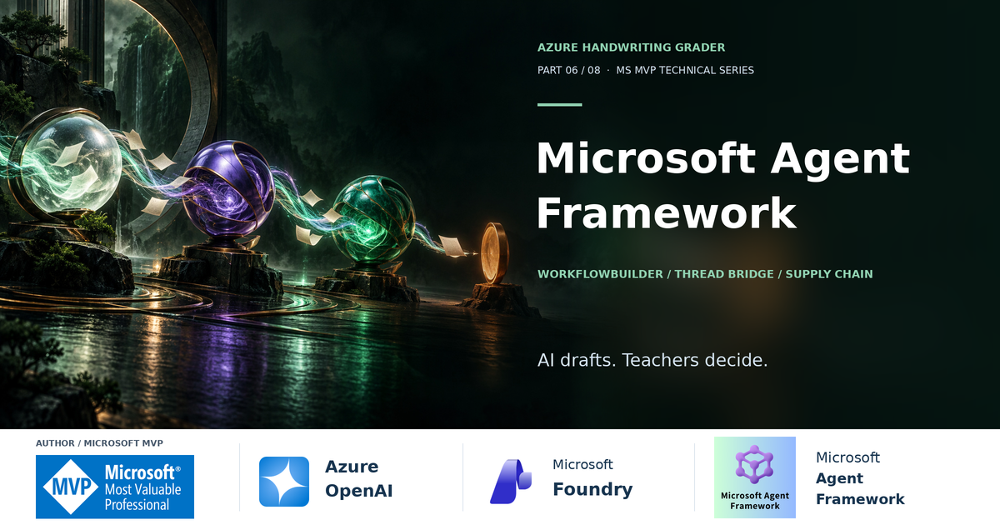
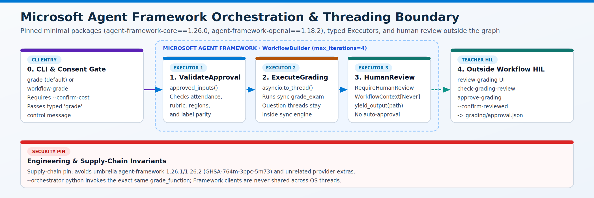

# Multi-Agent Orchestration: Skill Policy vs. Microsoft Agent Framework

*Part 6 of 8 · MS MVP Technical Series · Agent Framework, Threading & Supply-Chain Security*



When developers hear "multi-agent system," they often picture three autonomous LLM personas debating each other in a loop until they agree on a grade. For high-stakes exam marking, **that pattern is an anti-pattern**: it multiplies latency and cost, obscures accountability, and blurs who actually approved a student's score.

In `azure-handwriting-grader-skills`, we use **Microsoft Agent Framework** (`WorkflowBuilder`, `Executor`, `WorkflowContext`, `@handler`) for what it does best: **explicit, typed, auditable state transitions** around a deterministic Python grading engine—while keeping `SKILL.md` as the conversational router and keeping human approval strictly outside the automated graph.

As [SKILL.md](../../skills/handwriting-grading/SKILL.md) summarizes:

```markdown
`grade` defaults to `--orchestrator agent-framework`: real Executor/WorkflowBuilder
validation → existing grading → human-review boundary. `workflow-grade` forces it;
`--orchestrator python` is the direct fallback. No autonomous approval or email.
```



*Figure 1. Actual Microsoft Agent Framework graph (`ValidateApproval -> ExecuteGrading -> RequireHumanReview`), `asyncio.to_thread` bridge, and outside-workflow HIL boundary.*

## Separating four layers of "agentic" responsibility

| Layer | Input | Owns | Explicitly Does NOT Own |
|---|---|---|---|
| **Skill-guided assistant (`SKILL.md`)** | Teacher intent + workspace files | Tool selection, stop rules, cost/review prompts | Inventing `--confirm-cost` or `--confirm-reviewed` |
| **Python CLI (`cli.py`)** | Explicit paths, target & flags | Preview, `--confirm-cost` gate, orchestrator routing | Proving conversational consent happened |
| **Microsoft Agent Framework (`workflow.py`)** | Typed `"grade"` control string | Graph sequencing: validate -> execute -> yield draft | Loading `SKILL.md`, negotiating marks, or approving |
| **Azure OpenAI (`grading.py`)** | Rubric text + sharpened PNG crops | Structured JSON transcription, marks, and flags | Approving its own output |

## Supply-chain security: why we pin minimal packages

Before writing a single `Executor`, `pyproject.toml` pins **`agent-framework-core==1.26.0`** and **`agent-framework-openai==1.18.2`**—and explicitly forbids installing the umbrella `agent-framework` package (`1.26.1` / `1.26.2`) or `[all]` extras.

Why? Advisory **[GHSA-764m-3ppc-5m73](https://github.com/advisories/GHSA-764m-3ppc-5m73)** documented credential-stealing malware in `agent-framework` `1.26.1` and `1.26.2`. Pinning the minimal pre-incident core/OpenAI packages via `uv.lock` avoids both the compromised versions and unrelated third-party provider SDKs.

## The CLI seam (`cli.py`) and complete `workflow.py` graph

After `cli.py` verifies `--confirm-cost`, it selects the orchestrator while keeping the underlying `grade_exam` engine identical:

```python
execute = grade_exam
options = {}
if args.orchestrator == "agent-framework":
    from .workflow import run_grading_workflow
    execute = run_grading_workflow
    options["grade_function"] = grade_exam
output = execute(
    config, path.parent, path, args.model_config, args.endpoint.strip(),
    args.api_version.strip(), summary, mode=mode, batch_concurrency=concurrency, **options,
)
```

Inside `workflow.py`, three typed `Executor` nodes form a linear, bounded (`max_iterations=4`) graph:

```python
def build_grading_workflow(config, config_dir, config_path, model_config_path,
                           endpoint, api_version, summary, *, mode="batch",
                           batch_concurrency=3, grade_function=grade_exam):
    class ValidateApproval(Executor):
        @handler
        async def process(self, request: str, ctx: WorkflowContext[str]) -> None:
            approved_inputs(config, config_dir, config_path)
            await ctx.send_message(request)

    class ExecuteGrading(Executor):
        @handler
        async def process(self, request: str, ctx: WorkflowContext[str]) -> None:
            output = await asyncio.to_thread(
                grade_function, config, config_dir, config_path, model_config_path,
                endpoint, api_version, summary,
                mode=mode, batch_concurrency=batch_concurrency,
            )
            await ctx.send_message(str(output))

    class RequireHumanReview(Executor):
        @handler
        async def process(self, output: str, ctx: WorkflowContext[Never, str]) -> None:
            await ctx.yield_output(output)

    validate = ValidateApproval(id="validate-human-approvals")
    execute = ExecuteGrading(id="grade-approved-crops")
    review = RequireHumanReview(id="await-human-score-review")
    return (
        WorkflowBuilder(
            start_executor=validate, name="human-reviewed-azure-grading",
            max_iterations=4,
        )
        .add_edge(validate, execute)
        .add_edge(execute, review)
        .build()
    )
```

```python
def run_grading_workflow(*args, **kwargs):
    async def run():
        workflow = build_grading_workflow(*args, **kwargs)
        events = await workflow.run("grade")
        outputs = events.get_outputs()
        if len(outputs) != 1:
            raise ValueError("Grading workflow did not produce exactly one output")
        return Path(outputs[0])

    return asyncio.run(run())
```

Three key engineering decisions stand out in this 60-line module:
1. **`"grade"` is control data, not a prompt**: `workflow.run("grade")` passes a typed control message between Executors. If `ValidateApproval` raises on a missing rubric or region hash, `ctx.send_message()` never fires.
2. **Async-to-sync bridge without shared clients**: `ExecuteGrading` uses `asyncio.to_thread()` to run the synchronous `grade_exam` engine (which manages its own question-level thread pool, `results.json` locks, and synchronous `AzureClient` instances). Framework clients are never shared across OS threads.
3. **Terminal yield, not autonomous approval**: `RequireHumanReview` uses `WorkflowContext[Never, str]` to yield the draft directory path (`grading/`) and terminate. Human review (`review-grading`) and `approve-grading` happen strictly outside the workflow.


*Figure 2. Existing engine output (`grading/manifest.json` & `results.json`): four scripts and 20 mark records.*

## Verifying the real Framework graph offline (0 Azure clients)

We can execute the real `agent-framework-core` `WorkflowBuilder` locally without touching student data or constructing an `AzureClient` by patching `approved_inputs` and injecting a local stub (`snippets/offline-framework-smoke.py`):

```python
from pathlib import Path
from tempfile import TemporaryDirectory
from unittest.mock import patch
from handwriting_grader.workflow import run_grading_workflow

order = []

def synthetic_validation(*args):
    order.append("validate")

def grading_stub(*args, **kwargs):
    order.append("grade_stub")
    return draft

with TemporaryDirectory() as directory:
    root = Path(directory)
    draft = root / "draft"
    draft.mkdir()
    with (
        patch("handwriting_grader.workflow.approved_inputs", side_effect=synthetic_validation) as validation,
        patch("handwriting_grader.grading.AzureClient",
              side_effect=AssertionError("Azure clients are forbidden in this offline example")) as azure,
    ):
        output = run_grading_workflow(
            {}, root, root / "synthetic-exam.yaml", root / "synthetic-models.yaml",
            "https://synthetic.openai.azure.com", "v1", {"students": 4},
            grade_function=grading_stub,
        )
        assert order == ["validate", "grade_stub"] and output == draft
        azure.assert_not_called()
        print("Execution order:", " -> ".join(order))
        print("Validation calls:", validation.call_count)
        print("Workflow output:", output.name)
        print("Azure clients constructed:", azure.call_count)
```

Running `uv run --frozen python docs/blog-series/snippets/offline-framework-smoke.py` produces:

```text
Execution order: validate -> grade_stub
Validation calls: 1
Workflow output: draft
Azure clients constructed: 0
```

Once the workflow yields `grading/`, the skill-guided assistant hands control back to the teacher to inspect flagged rows and run `review-grading`.


*Figure 3. Flagged rows in `review.xlsx` that remain for human judgment after the Framework workflow yields its draft path.*

Next: [Fail-Closed Cost Governance: Retail Price Verification, Token Math, and Caching](07-pricing-and-data.md).

**Implementation references:** [complete workflow source](https://github.com/wongcyrus/azure-handwriting-grader-skills/blob/b6af53dd1cf4cf74b9a50591f0e775a3b1533133/src/handwriting_grader/workflow.py) and [CLI orchestrator routing](https://github.com/wongcyrus/azure-handwriting-grader-skills/blob/b6af53dd1cf4cf74b9a50591f0e775a3b1533133/src/handwriting_grader/cli.py).
