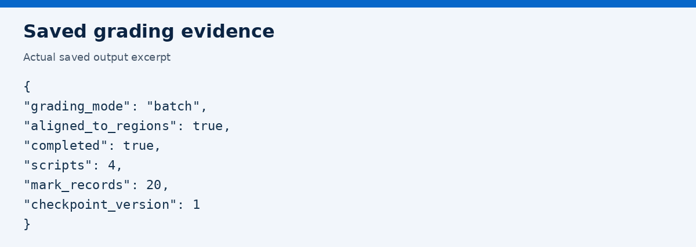
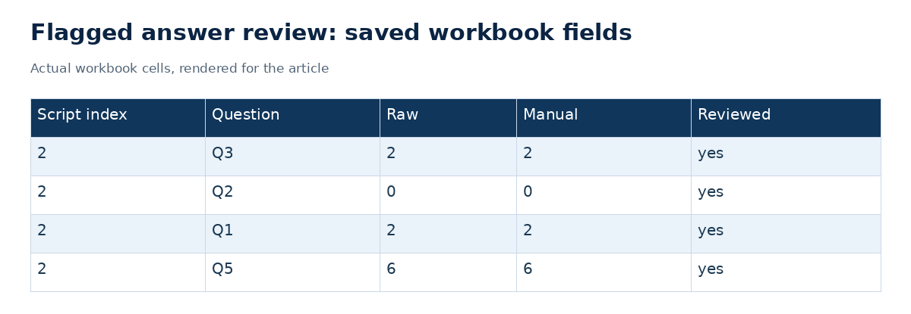

# What Microsoft Agent Framework actually orchestrates in a grading application

*Part 6 of 8 · For agent and application developers*


An “agentic” architecture diagram can easily imply more autonomy than the code provides. This application uses real Microsoft Agent Framework Executors and a workflow, but it does not ask a group of autonomous agents to negotiate grades or grant approval.

The workflow is deliberately small: validate inputs, execute the existing grading engine, and return a draft location for human review. Pricing and review policy remain application responsibilities.

This article shows the actual code and the saved artifacts the grading engine produces. No framework event log was captured for the existing example, so those artifacts are not presented as proof of which orchestrator ran historically.

## Step 1: State the workflow's contract

The workflow imports:

```python
from agent_framework import Executor, WorkflowBuilder, WorkflowContext, handler
```

Its input is a grading request with the configured exam context captured by the builder. Its output is one path to generated grading artifacts.


*Figure 1. Diagram of actual workflow structure, not a runtime event visualization.*

The last box is particularly important. “Human review boundary” means the automated workflow stops without granting approval. It does **not** mean the Executor waits for a teacher response and persists that approval.

## Step 2: Validate before executing

The first Executor's handler calls application validation:

```python
class ValidateApproval(Executor):
    @handler
    async def process(self, request: str, ctx: WorkflowContext[str]) -> None:
        approved_inputs(config, config_dir, config_path)
        await ctx.send_message(request)
```

**Output:** the request is forwarded only if validation returns successfully. A failing validation stops this path before the grading Executor is invoked.

The framework provides orchestration primitives. The application supplies the meaning of “approved inputs,” including rubric/region checks. Adding an Executor does not automatically implement those policies.

Part 1's actual scan warning is related but belongs to scan checking; do not label it as a captured `ValidateApproval` event.

## Step 3: Run the synchronous engine without blocking the event loop

The second Executor uses:

```python
output = await asyncio.to_thread(
    grade_function,
    config, config_dir, config_path, model_config_path,
    endpoint, api_version, summary,
    mode=mode,
    batch_concurrency=batch_concurrency,
)
await ctx.send_message(str(output))
```

This is a reformatted source excerpt. `asyncio.to_thread` bridges the existing synchronous grading function into the asynchronous handler. It does not transform each rubric rule into a separate agent or remove the engine's own concurrency and transport constraints.

The engine writes outputs such as:

```text
grading/
  manifest.json
  results.json
  review.xlsx
  images/
  telemetry/
```



*Figure 2. Existing engine output: four scripts and twenty question-mark records. This is not a framework execution trace.*

A practical benefit is reuse: direct Python orchestration and the framework path call the same engine, preserving the review/checkpoint model.

## Step 4: Yield drafts without inventing human approval

The final Executor does this:

```python
class RequireHumanReview(Executor):
    @handler
    async def process(self, output: str, ctx: WorkflowContext[Never, str]) -> None:
        await ctx.yield_output(output)
```

Despite the class name, there is no human response wait in that handler. It yields the draft output path. Review and approval occur through separate application operations.

**Suggested operator prompt**

```text
Run the approved grading workflow only after I confirm cost.
When it finishes, show the draft output location and flagged answers.
Do not approve scores, generate a delivery approval or send email.
```

This is a suggested assistant request, not the model prompt used to grade handwriting. The assistant must still respect the explicit consent and local approval gates.

## Step 5: Connect the real Executors

The builder creates these edges:

```python
return (
    WorkflowBuilder(
        start_executor=validate,
        name="human-reviewed-azure-grading",
        max_iterations=4,
    )
    .add_edge(validate, execute)
    .add_edge(execute, review)
    .build()
)
```

The wrapper runs the workflow, requires exactly one output, and converts that output back to `Path`.

The default CLI selects the framework path. `--orchestrator python` selects the direct implementation; `workflow-grade` forces the workflow route. These are application choices, not two different grading quality guarantees.

**Evidence limitation:** the saved manifest records grading mode, not a complete framework event history. This package includes the exact inspected `workflow.py`, but does not claim a new paid workflow run.

## Step 6: Review the thing the workflow cannot approve

The saved workbook includes flagged answers with manual-review fields. The current read-only review diagnostic reports no discrepancies while explicitly reminding the operator that human review and approval remain required.



*Figure 3. Actual saved review records, not evidence that the final Executor granted approval.*

Deployment hygiene matters too. Use the reviewed lockfile and consult current advisories before changing framework dependencies. A historical pre-incident pin is not a permanent safety certification.

The architectural lesson is straightforward: use the framework to make sequencing visible, but keep correctness, consent, pricing and release rules explicit in application code. A modest workflow that accurately describes its authority is preferable to a spectacular diagram that overstates it.

Next: [pricing and data boundaries before AI calls](07-pricing-and-data.md).

**Implementation reference:** [complete workflow source at the inspected revision](https://github.com/wongcyrus/azure-handwriting-grader-skills/blob/b6af53dd1cf4cf74b9a50591f0e775a3b1533133/src/handwriting_grader/workflow.py).
