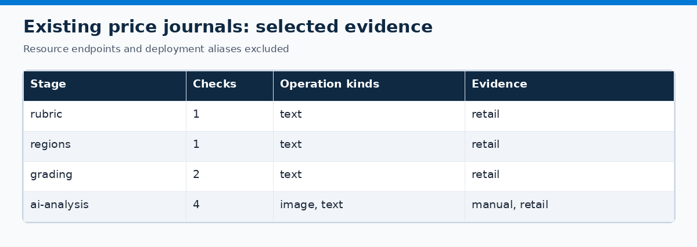

# Cost governance in an agent skill: Python gates before Azure requests

*Part 7 of 8 · For developers and school IT*


An assistant that can invoke a paid tool needs more than a friendly "are you
sure?" prompt. The handwriting-grading skill tells it to prepare a meaningful
consent decision; Python independently checks the selected operation's pricing
and explicit consent flag. Microsoft Agent Framework does not supply a spending
authorization merely by starting the grading graph.

The actual instruction in
[SKILL.md](../../skills/handwriting-grading/SKILL.md) is:

```markdown
**Cost governance**: Before every paid stage, preview target, transferred data and
estimated requests; independently verify current regional deployment rates and
obtain `--confirm-cost`.
```

"What did this cost?" and "May we send these images?" are different questions.
The skill-guided assistant explains both and waits for a real user decision.
The executable flag prevents an ordinary unconfirmed invocation, but the program
cannot prove a host assistant obtained genuine conversational consent. Skill
instructions and program checks are complementary, not interchangeable.

The grader checks required rates before the first paid request of each new run. Public lookup covers a curated set of supported text/vision families. Other operations need current manually reviewed evidence. This article uses saved price journals and cost summaries; no new model request or price refresh was made to write it.

## The skill prepares a decision, not a chain of paid commands

A preview should show intended work without inference. It is not consent to execute. The relevant execution additionally needs `--confirm-cost`, and a configured deployment still needs verified rates.

**Illustrative teacher/IT request**

```text
Use the handwriting-grading skill to plan the next paid stage.
Show the target resource and deployments locally.
Explain which artifacts will leave the machine and preview the work.
Do not make paid calls, accept changed rates or send reports.
```

Do not put the private resource details into public screenshots. The article's examples deliberately use placeholders.


*Figure 1. Code-authored decision diagram, not a captured provider response.*

The order of authorization and checking is an application workflow; the invariant is that neither missing consent nor a failed price check may be bypassed to make the paid request.

The assistant should explain the selected stage, endpoint/deployment, payload,
request estimate, retry caveats and whether required reviews are current.
For grading the data includes answer crops and selected metadata; for analysis
it includes reviewed answers/feedback. A public price lookup has neither payload.
A scan blocker or invalid approval remains a reason not to proceed, even when
rates are available.

## Why pricing lookup is a Python operation, not an LLM answer

The skill tells the assistant to obtain the actual ARM region and billing type
rather than infer them from an endpoint. The `fetch-pricing` tool queries the
public Retail Prices API and can write a **new** private configuration only when
requested. Python matches meters and retains provenance. The assistant presents
that result for review; it must not overwrite approval-bound configuration or
invent a new attestation timestamp. No fresh lookup was executed for this article.

The public Retail Prices API request does not need student data or Azure credentials. The application selects exact matching meters, checks units and effective dates, and retains provenance rather than guessing a family rate.

Use the real ARM region and billing type. Public USD retail rates are estimates, not your institution's negotiated bill.

## Trace the Python check immediately before the request

The existing grading price journal contains two text-operation checks with retail evidence. Rubric and region journals each contain a text check. The analysis journal contains both text and image checks, with retail and manual evidence represented.



*Figure 2. Selected actual journal fields. Resource identifiers, private paths and unrelated configuration are excluded.*

At the transport boundary the shared client calls:

```python
self._require_prices(model, tools=tuple(config.tools or ()))
```

That precedes image encoding and the Responses SDK request. A shared run verifier checks the configuration fingerprint, binds the intended request to reviewed configuration, and compares required fresh rates with saved reviewed rates. Failures latch the run as blocked.

**What is not captured here:** a fresh changed-price/network-failure execution. Those blocking branches are source behavior, not fabricated console output.

`model` identifies the actual configured deployment used by this call.
`tools=tuple(config.tools or ())` includes hosted-tool requirements and uses an
empty tuple when none are requested. `_require_prices()` therefore checks the
operation being sent, not merely whether some unrelated rate exists in YAML.
The Framework's execution node invokes an engine whose transport performs this
check; the Framework itself is not the rate authority.

## The assistant must explain scope when reporting actual usage

The saved `grading/cost_summary.json` reports:

```json
{
  "total_calls": 26,
  "total_prompt_tokens": 26464,
  "total_candidate_tokens": 15234,
  "total_images": 6,
  "total_cost_usd": 0.33436,
  "unpriced_calls": 0
}
```


*Figure 3. Actual stored summary, including its broader accumulated phase scope.*

Despite its location under `grading/`, this file includes rubric extraction, region suggestions, OCR, batch grading, AI analysis and image generation. **US$0.33436 is not the price of grading four students alone.**

The stored batch-grading phase is five logical calls and US$0.022736. The stored infographic phase is six calls and US$0.25453. These figures describe this saved accounting snapshot, not a promise about another exam.

Failed responses and individual SDK retries are not fully represented in the grader's log. Do not turn logical calls into an authoritative count of billed attempts. Reconcile with Azure billing.

## Different grader operations require different pricing evidence

A reviewed text/vision rate is not authorization for optional embeddings,
hosted search or report infographics. Those operations have different payloads
and billing requirements; unsupported automatic-lookup families need current
manual evidence. The skill must explain the specific choice and obtain separate
consent rather than reuse the teacher's earlier approval to mark the exam.

## Keep data governance visible in the skill's handoff

Answer crops and selected metadata can leave the local machine during inference. Optional analysis and hosted tools have their own payloads and cost implications. Local previews, reports and offline statistics should not be described as paid AI operations.

Keep credentials outside configuration committed to source control. Keep private review URLs, journals, scans and delivery settings out of public article assets. `store=False` is not a substitute for institutional review of access, retention, contractual terms and student-data handling.

## Technical walkthrough: the price gate and token arithmetic

### There is intentionally no LLM pricing prompt

The operator prompt in Step 1 requests a preview. Python, not an AI answer to
"what does this model cost?", makes the execution decision. The price verifier
checks a particular endpoint, deployment, operation, tools and image size against
the reviewed configuration. Looking up a public USD rate does not transmit an
exam; the later inference operation has a different payload and consent boundary.

### A deployment alias is not a model family or a price

`RunPricingVerifier._load()` hashes the private configuration bytes and rejects a
changed signature during the same run. It resolves configured deployment names
to declared underlying families and verifies the target Azure endpoint. The
binding key includes endpoint, deployment, operation kind, hosted tools and image
size, so a text check cannot silently authorize an image or tool operation.

For the curated auto-lookup families, this is the actual comparison core:

```python
required = ("input", "cached", "output", "cache_write")
rates = self._rates({
    "long_context_threshold": report["long_context_threshold"],
    **entry["tiers"],
}, required, tiered=True)
reviewed = self._rates(row, required, tiered=True)
if (
    reviewed["long_context_threshold"] != rates["long_context_threshold"]
    or any(
        reviewed[tier][part] != rates[tier][part]
        for tier in ("short", "long") for part in required
    )
):
    raise PriceVerificationError("Current retail prices differ from reviewed rates")
```

`required` names the token-rate components that must be known. `_rates()` builds
comparable short/long-context mappings from fresh retail evidence and the
reviewed configuration. The condition checks both the tier threshold and every
required component in each tier. `any(...)` blocks on even one changed rate;
it does not silently accept a "close enough" total estimate. This is why the
assistant cannot fix the failure by merely asking an LLM for a cheaper number.

The public lookup validates pagination, meter identity, units and effective
dates. Missing or ambiguous meters remain unpriced. Unsupported families use
manual evidence instead: matching family/resource/region/billing mode, official
reference, declared units and a timezone-bearing timestamp reviewed today UTC.
The program checks the attestation's structure and consistency; it cannot prove
that its author read the correct rate table.

On failure, the verifier latches the reason:

```python
self._blocked_reason = message
raise PriceVerificationError(message) from exc
```

A later call in that run is still blocked. The remedy is to review a new priced
configuration and start a new run, not to retry around the gate. The saved price
journal above is evidence of checks already recorded; no new live changed-rate
failure is claimed for this article.

### How the cost calculation avoids double counting

Let `P` be input tokens, `C` cached input tokens, `W` cache-write tokens and `O`
output tokens. For a supported row, ordinary input is `P - C - W`; cache reads
and writes have their own rates. The exact source mapping is:

```python
counts = {
    "input": prompt_tokens - cached_tokens - cache_write_tokens,
    "cached": cached_tokens,
    "output": candidate_tokens,
    write_key: cache_write_tokens,
    "image": images_count,
}
cost = 0.0
for key, count in counts.items():
    if count:
        if not valid_rate(rates.get(key)):
            return None
        cost += count * float(rates[key]) / (1 if key == "image" else 1_000_000)
```

This excerpt follows the count validation and tier selection in
`TelemetryTracker._priced_cost()`. Token rates are per million; the `image` field
is per generated image. `write_key` selects the 30-minute or 12-hour write rate.
Cached/write counts cannot exceed the input count. Unknown write usage for a
row requiring those rates remains unpriced.

For tiered rates, the implementation selects:

```python
rates = rates.get("long" if prompt_tokens > threshold else "short", {})
```

The selected tier prices the whole request, not just the tokens above the
threshold. Do not add reasoning-detail tokens again on top of the total output
count merely because they appear in a separate diagnostic field.

### Unknown cost is a state, not a zero-price success

A legacy per-call trace may hold a numeric `cost_usd` sentinel of zero while
`cost_known` is false. `get_summary()` checks the known-state flags and sets an
affected phase/model total, and the overall total, to null. Always interpret the
known-state field or summary, not just a numeric cell. Billing estimates still
omit some failed attempts and SDK retries; the provider invoice is authoritative.

The **actual stored outputs** are the broader US$0.33436 summary and its phase
breakdown above. The assistant should report that scope, identify missing usage
or pricing, and distinguish recorded estimates from the institution's Azure bill.

The output you want is a traceable estimate with known scope—and a clearly blocked request when essential evidence is missing—not an attractively formatted zero.

Next: [turn saved reports into a measured school pilot](08-pilot-and-outputs.md).


**Implementation references:** [price verification](https://github.com/wongcyrus/azure-handwriting-grader-skills/blob/b6af53dd1cf4cf74b9a50591f0e775a3b1533133/src/handwriting_grader/pricing.py) and [usage accounting](https://github.com/wongcyrus/azure-handwriting-grader-skills/blob/b6af53dd1cf4cf74b9a50591f0e775a3b1533133/src/handwriting_grader/telemetry.py).
