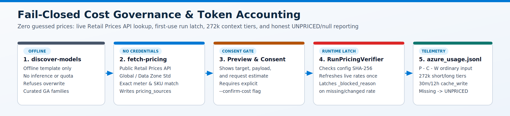

# Check prices before AI: consent, estimates and data boundaries

*Part 7 of 8 · For developers and school IT*


“What did this cost?” and “May we send these images?” are different questions. A responsible workflow must address both before a paid request, and preserve enough evidence to explain its estimate afterwards.

The grader checks required rates before the first paid request of each new run. Public lookup covers a curated set of supported text/vision families. Other operations need current manually reviewed evidence. This article uses saved price journals and cost summaries; no new model request or price refresh was made to write it.

## Step 1: Separate preview, price verification and consent

A preview should show intended work without inference. It is not consent to execute. The relevant execution additionally needs `--confirm-cost`, and a configured deployment still needs verified rates.

**Suggested teacher/IT prompt**

```text
Show the target resource and deployments locally.
Explain which artifacts will leave the machine and preview the work.
Do not make paid calls, accept changed rates or send reports.
```

Do not put the private resource details into public screenshots. The article's examples deliberately use placeholders.



*Figure 1. Code-authored decision diagram, not a captured provider response.*

The order of authorization and checking is an application workflow; the invariant is that neither missing consent nor a failed price check may be bypassed to make the paid request.

## Step 2: Understand what public lookup retrieves

The documented lookup command is:

```bash
handwriting-grader fetch-pricing \
  --region eastus --deployment-type global-standard
```

To price aliases into a new private configuration:

```bash
handwriting-grader fetch-pricing \
  --region eastus --deployment-type global-standard \
  --model-config /private/config.yaml \
  --write-config /private/priced-config.yaml
```

These are reproducible procedure examples, not newly executed transcripts. The saved journals provide actual evidence of earlier successful checks.

The public Retail Prices API request does not need student data or Azure credentials. The application selects exact matching meters, checks units and effective dates, and retains provenance rather than guessing a family rate.

Use the real ARM region and billing type. Public USD retail rates are estimates, not your institution's negotiated bill.

## Step 3: Inspect saved evidence without publishing the private resource

The existing grading price journal contains two text-operation checks with retail evidence. Rubric and region journals each contain a text check. The analysis journal contains both text and image checks, with retail and manual evidence represented.


*Figure 2. Selected actual journal fields. Resource identifiers, private paths and unrelated configuration are excluded.*

At the transport boundary the shared client calls:

```python
self._require_prices(model, tools=tuple(config.tools or ()))
```

That precedes image encoding and the Responses SDK request. A shared run verifier checks the configuration fingerprint, binds the intended request to reviewed configuration, and compares required fresh rates with saved reviewed rates. Failures latch the run as blocked.

**What is not captured here:** a fresh changed-price/network-failure execution. Those blocking branches are source behavior, not fabricated console output.

## Step 4: Read the cost report's scope before quoting a number

The saved `grading/cost_summary.json` reports:

```json
{
  "total_calls": 26,
  "total_prompt_tokens": 26464,
  "total_candidate_tokens": 15234,
  "total_images": 6,
  "total_cost_usd": 0.33436,
  "unpriced_calls": 0
}
```


*Figure 3. Actual stored summary, including its broader accumulated phase scope.*

Despite its location under `grading/`, this file includes rubric extraction, region suggestions, OCR, batch grading, AI analysis and image generation. **US$0.33436 is not the price of grading four students alone.**

The stored batch-grading phase is five logical calls and US$0.022736. The stored infographic phase is six calls and US$0.25453. These figures describe this saved accounting snapshot, not a promise about another exam.

Failed responses and individual SDK retries are not fully represented in the grader's log. Do not turn logical calls into an authoritative count of billed attempts. Reconcile with Azure billing.

## Step 5: Treat image generation as a separate pricing case

The independent [Azure image-generation skill](https://github.com/wongcyrus/azure-image-generation-skills) has its own package and environment. It is not a grader dependency.

Its current image-pricing gate checks **manual evidence**, not a live image-price lookup. Evidence must match the model/resource, region, supported billing mode, USD units, current UTC verification date, requested size and quality. The program validates the attestation; it cannot establish that a person actually reviewed the correct prices.

The separately created workflow illustration used one image request and recorded an estimated US$0.04312. That separate run is not included in the grader's stored US$0.33436 snapshot. The earlier banner prototype used one request (estimated US$0.00713). The current eight banners instead use **eight distinct, separately generated artworks**, with no automatic retries and a combined estimate of **US$0.06394**. Exact typography and brand marks are added locally. [Submitted prompts and provenance](branding/README.md) distinguish these conceptual illustrations from observed grader outputs. None of these publication-art costs belong to the grader's stored snapshot; estimates are not invoices.

## Step 6: Keep consent and data governance visible

Answer crops and selected metadata can leave the local machine during inference. Optional analysis and hosted tools have their own payloads and cost implications. Local previews, reports and offline statistics should not be described as paid AI operations.

Keep credentials outside configuration committed to source control. Keep private review URLs, journals, scans and delivery settings out of public article assets. `store=False` is not a substitute for institutional review of access, retention, contractual terms and student-data handling.

## Technical walkthrough: the price gate and token arithmetic

### There is intentionally no LLM pricing prompt

The operator prompt in Step 1 requests a preview. Python, not an AI answer to
"what does this model cost?", makes the execution decision. The price verifier
checks a particular endpoint, deployment, operation, tools and image size against
the reviewed configuration. Looking up a public USD rate does not transmit an
exam; the later inference operation has a different payload and consent boundary.

### A deployment alias is not a model family or a price

`RunPricingVerifier._load()` hashes the private configuration bytes and rejects a
changed signature during the same run. It resolves configured deployment names
to declared underlying families and verifies the target Azure endpoint. The
binding key includes endpoint, deployment, operation kind, hosted tools and image
size, so a text check cannot silently authorize an image or tool operation.

For the curated auto-lookup families, this is the actual comparison core:

```python
required = ("input", "cached", "output", "cache_write")
rates = self._rates({
    "long_context_threshold": report["long_context_threshold"],
    **entry["tiers"],
}, required, tiered=True)
reviewed = self._rates(row, required, tiered=True)
if (
    reviewed["long_context_threshold"] != rates["long_context_threshold"]
    or any(
        reviewed[tier][part] != rates[tier][part]
        for tier in ("short", "long") for part in required
    )
):
    raise PriceVerificationError("Current retail prices differ from reviewed rates")
```

The public lookup validates pagination, meter identity, units and effective
dates. Missing or ambiguous meters remain unpriced. Unsupported families use
manual evidence instead: matching family/resource/region/billing mode, official
reference, declared units and a timezone-bearing timestamp reviewed today UTC.
The program checks the attestation's structure and consistency; it cannot prove
that its author read the correct rate table.

On failure, the verifier latches the reason:

```python
self._blocked_reason = message
raise PriceVerificationError(message) from exc
```

A later call in that run is still blocked. The remedy is to review a new priced
configuration and start a new run, not to retry around the gate. The saved price
journal above is evidence of checks already recorded; no new live changed-rate
failure is claimed for this article.

### How the cost calculation avoids double counting

Let `P` be input tokens, `C` cached input tokens, `W` cache-write tokens and `O`
output tokens. For a supported row, ordinary input is `P - C - W`; cache reads
and writes have their own rates. The exact source mapping is:

```python
counts = {
    "input": prompt_tokens - cached_tokens - cache_write_tokens,
    "cached": cached_tokens,
    "output": candidate_tokens,
    write_key: cache_write_tokens,
    "image": images_count,
}
cost = 0.0
for key, count in counts.items():
    if count:
        if not valid_rate(rates.get(key)):
            return None
        cost += count * float(rates[key]) / (1 if key == "image" else 1_000_000)
```

This excerpt follows the count validation and tier selection in
`TelemetryTracker._priced_cost()`. Token rates are per million; the `image` field
is per generated image. `write_key` selects the 30-minute or 12-hour write rate.
Cached/write counts cannot exceed the input count. Unknown write usage for a
row requiring those rates remains unpriced.

For tiered rates, the implementation selects:

```python
rates = rates.get("long" if prompt_tokens > threshold else "short", {})
```

The selected tier prices the whole request, not just the tokens above the
threshold. Do not add reasoning-detail tokens again on top of the total output
count merely because they appear in a separate diagnostic field.

### Unknown cost is a state, not a zero-price success

A legacy per-call trace may hold a numeric `cost_usd` sentinel of zero while
`cost_known` is false. `get_summary()` checks the known-state flags and sets an
affected phase/model total, and the overall total, to null. Always interpret the
known-state field or summary, not just a numeric cell. Billing estimates still
omit some failed attempts and SDK retries; the provider invoice is authoritative.

The **actual stored outputs** are the broader US$0.33436 summary and its phase
breakdown above. The separate eight-banner estimate of US$0.06394 was calculated
by the independent image tool from eight successful usage records. It is neither
the exam's grading cost nor a public quote for eight future requests.

The output you want is a traceable estimate with known scope—and a clearly blocked request when essential evidence is missing—not an attractively formatted zero.

Next: [turn saved reports into a measured school pilot](08-pilot-and-outputs.md).

<!-- BEGIN BANNER WALKTHROUGH -->
## Reproduce this article's AI banner: full prompt, code and output

The banner is a separate illustration task, not an image of a running grader or
evidence that an assessment succeeded. Its article title, description, visual
metaphor, palette and composition are all in the **complete actual submitted
prompt** below. No reference images or official logos were sent in this request.

### Stage A: the actual Azure image prompt

```text
Create a visually arresting premium editorial cover illustration for a Microsoft technical blog, not a slide, diagram or screenshot.

Article title: Check prices before AI: consent, estimates and data boundaries.
Description: Preview is not consent. Reviewed rates and permission to send data must both exist before a paid request. Estimates, actual usage and unknown costs need distinct treatment; missing evidence must block rather than imply a free operation.

Creative concept: THE COST GATE. On the RIGHT, a jewel-like precision balance with two transparent pans stands immediately before a luminous closed glass doorway. One pan holds folded ivory paper; the other contains tiny solid gold weights, not coins. A fine stream of light approaches the closed doorway but stops at its threshold. Rich matte black, brushed champagne gold, warm amber and a restrained electric-blue edge reflection. Luxurious product-editorial photography, tactile materials, spotlight, deep shadows and carefully controlled reflections.

The balance and doorway should form one bold, instantly recognizable silhouette: deliberate judgment before spending or transmission. No cryptocurrency, currency symbols, price numbers, invoice, calculator, stock-market chart, generic padlock or cluttered desk.

Composition: leave the LEFT 42 percent quiet matte black for large typography added later. Place the balance and cost gate on the right. Keep the essential sculpture inside the central horizontal band of a 1536x1024 canvas, approximately y=190 to y=830, so a wide 1200x515 crop retains both pans and doorway. Full-bleed, no borders.

No titles, letters, numbers, logos, badges, watermarks, interfaces or fabricated billing evidence. This is conceptual editorial art, not an invoice or price quote. Prioritize elegance, dramatic gold-black contrast, intrigue and exceptional thumbnail appeal.
```

This prompt's retained source is `branding/prompts/07.txt`. Asking for no
rendered words leaves typography to local code; the quiet side reserves space
for the headline. The image-size/crop instructions guide composition but do not
guarantee the model obeys every visual constraint, so the result was inspected.

### Stage B: preview and the real API boundary

Use the independent image-generation repository's own environment and a newly
reviewed private Azure configuration. The following command is an **offline
preview example**, not a paid request executed while rebuilding this article:

```bash
"/path/to/azure-image-generation-skills/.venv/bin/azure-image" \
  --model-config /private/image.config.yaml \
  --prompt-file "/path/to/azure-handwriting-grader-skills/docs/blog-series/branding/prompts/07.txt" \
  --output-dir /private/new-banner-part-07
```

Paid execution adds `--confirm-cost` only after explicit approval for one request.
The attempt directory must be new. Pricing is checked before SDK construction
and again at this actual source method from the independent tool:

```python
def generate(self, prompt):
    self.verifier.verify()
    return self.sdk.with_options(max_retries=0).images.generate(
        model=self.settings.model, prompt=prompt, size=IMAGE_SIZE,
        quality=IMAGE_QUALITY, n=1,
    )
```

`IMAGE_SIZE` is `1536x1024` and `IMAGE_QUALITY` is `auto`. `n=1` requests one
image; SDK and per-call retries are disabled. The SDK returns inline base64
image data. The tool decodes it, verifies PNG format and exact dimensions, saves
the original and keeps private usage/price journals. The published method
excerpt is from
[image-tool commit ee6c616](https://github.com/wongcyrus/azure-image-generation-skills/blob/ee6c616cdeac43a9c97b0261049cb278fd5449b5/src/azure_image_generation/client.py);
it is not a standalone script and is not installed as part of the grader.

**Observed output for this article:** one successful text-to-image request using
`gpt-image-2.5-sunburst`, with estimated cost **US$0.006535**.
This is historical usage evidence, not a guaranteed future quote or an invoice.


*Banner stage B output. A metadata-free JPEG publication derivative of the actual
1536 x 1024 generated PNG, before local typography and logos; not a fabricated
application screenshot.*

### Stage C: preserve the scene, then add exact words and retained brand assets

The publication builder creates a blurred background extension and fits the
complete generated scene without stretching it. Its relevant Pillow excerpt is:

```python
full_scene = ImageOps.contain(artwork, hero.size, Image.Resampling.LANCZOS)
hero.paste(full_scene, (x, 0), mask)
```

`hero` is the upper banner canvas, `x` anchors the scene opposite the headline,
and `mask` feathers the quiet edge into the background. The builder varies
left/right placement and light/dark text by article. `ImageDraw.text()` writes
the exact headline; the four retained brand assets are resized proportionally
and composited into a separate strip. AI is not asked to redraw those marks.

**Final output:** the [1200 x 630 PNG shown at the top](media/07-banner.png),
plus a 2400 x 1260 JPEG layout master. The larger master upscales layout and
artwork; it is not newly generated high-resolution detail. Original PNG and
submitted-prompt hashes are retained in `branding/artwork-provenance.json`.
[Local composition source](tools/banners.py) and
[brand-source/permission caveats](branding/README.md) are included.

Rebuilding Markdown/HTML, JPEG derivatives and banners is local work. It does
not regenerate artwork, refresh prices or authorize any new paid operation.
<!-- END BANNER WALKTHROUGH -->

**Implementation references:** [price verification](https://github.com/wongcyrus/azure-handwriting-grader-skills/blob/b6af53dd1cf4cf74b9a50591f0e775a3b1533133/src/handwriting_grader/pricing.py) and [usage accounting](https://github.com/wongcyrus/azure-handwriting-grader-skills/blob/b6af53dd1cf4cf74b9a50591f0e775a3b1533133/src/handwriting_grader/telemetry.py).
