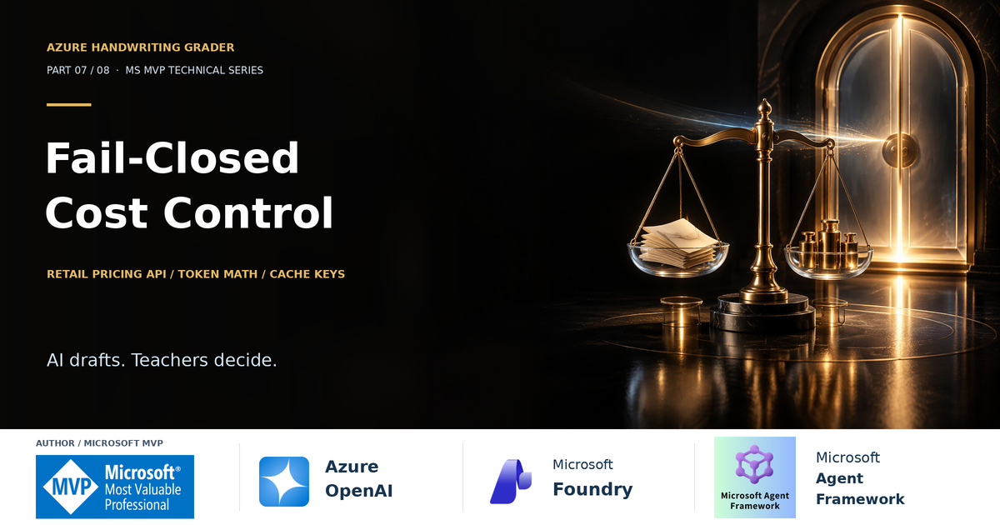
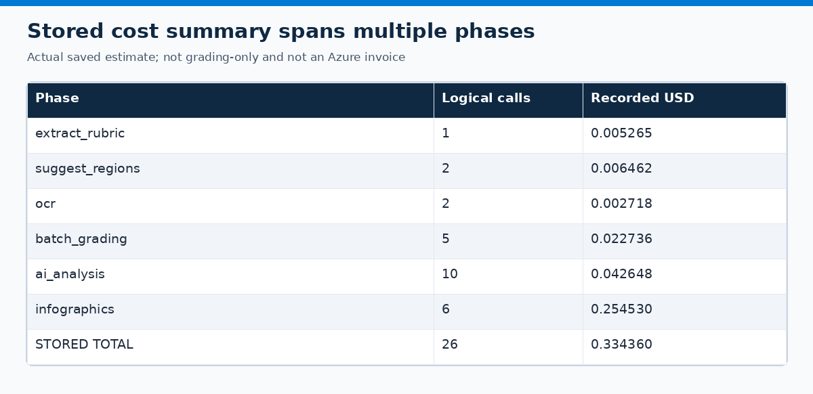

# Fail-Closed Cost Governance: Retail Price Verification, Token Math, and Caching

*Part 7 of 8 · MS MVP Technical Series · Azure Pricing API, Runtime Latches & Telemetry*



Asking an LLM "how much will this cost?" is a recipe for silent budget surprises. Hardcoding stale per-token constants in Python isn't much better.

In `azure-handwriting-grader-skills`, cost governance is **fail-closed**: zero guessed default rates, live verification against Microsoft's public Retail Prices API, explicit `--confirm-cost` consent before every paid stage, and honest `UNPRICED` (`null`) accounting whenever pricing or usage is incomplete.

As [SKILL.md](../../skills/handwriting-grading/SKILL.md) specifies:

```markdown
**Cost governance**: Before every paid stage, preview target, transferred data and
estimated requests; independently verify current regional deployment rates and
obtain `--confirm-cost`.
```


*Figure 1. Five-stage cost governance flow: offline template discovery, live Retail Prices API lookup, `--confirm-cost` consent, runtime `RunPricingVerifier` latch, and `azure_usage.jsonl` accounting.*

## 1. Offline discovery vs. live Retail Prices API (`fetch-pricing`)

- **`discover-models --endpoint URL --write-config config.yaml`**: Strictly **offline**. Writes a template with curated GA model recommendations (`gpt-6.1-terra`, `gpt-6-luna`, `gpt-6.2-sol`, `gpt-6.2-astra`) and refuses overwrite. It makes zero Azure calls.
- **`fetch-pricing --region eastus --deployment-type global-standard`**: Queries Microsoft's **unauthenticated** public Retail Prices API (`prices.azure.com`). It sends no credentials, endpoints, deployment aliases, or student data. It matches exact Global Standard or Data Zone Standard meters, populates short/long-context (`272,000`-token threshold) and `30m`/`12h` cache-write rates, and retains `pricing_sources` provenance (meter IDs, SKUs, effective dates). Unsupported models (such as `analytics_image` or embeddings) require today-dated UTC manual pricing evidence.

## 2. The runtime `RunPricingVerifier` latch

Right before `AzureClient` encodes images or calls `responses.create()`—even when invoked through Microsoft Agent Framework's `ExecuteGrading` Executor—it enforces:

```python
self._require_prices(model, tools=tuple(config.tools or ()))
```

`RunPricingVerifier` hashes the private `config.yaml` bytes, refreshes public retail rates once per run/region/billing profile, and checks every component (`input`, `cached`, `output`, `cache_write`) across both short and long tiers:

```python
required = ("input", "cached", "output", "cache_write")
rates = self._rates({
    "long_context_threshold": report["long_context_threshold"],
    **entry["tiers"],
}, required, tiered=True)
reviewed = self._rates(row, required, tiered=True)
if (
    reviewed["long_context_threshold"] != rates["long_context_threshold"]
    or any(
        reviewed[tier][part] != rates[tier][part]
        for tier in ("short", "long") for part in required
    )
):
    raise PriceVerificationError("Current retail prices differ from reviewed rates")
```

If any rate is missing, stale, ambiguous, or changed, the verifier latches `self._blocked_reason` so subsequent calls in the same run remain blocked until the operator reviews a new priced configuration.


*Figure 2. Selected fields from `azure_price_checks.jsonl` across rubric, region, grading, and AI analysis stages.*

## 3. Token arithmetic without double counting (`telemetry.py`)

Azure Responses usage reports total prompt tokens (`P`), cached input tokens (`C`), cache-write tokens (`W`), and output tokens (`O`). To avoid double-counting cached or cache-write tokens as ordinary input, `TelemetryTracker._priced_cost()` computes:

```python
counts = {
    "input": prompt_tokens - cached_tokens - cache_write_tokens,
    "cached": cached_tokens,
    "output": candidate_tokens,
    write_key: cache_write_tokens,
    "image": images_count,
}
cost = 0.0
for key, count in counts.items():
    if count:
        if not valid_rate(rates.get(key)):
            return None
        cost += count * float(rates[key]) / (1 if key == "image" else 1_000_000)
```

For tiered models, the entire request is priced at the selected tier (`prompt_tokens > 272000` -> `"long"`, else `"short"`):

```python
rates = rates.get("long" if prompt_tokens > threshold else "short", {})
```

Crucially, if any required rate is missing, `_priced_cost()` returns `None` (`UNPRICED`), never `0.0`.

## 4. Reporting scope honestly (`cost_summary.json`)

In our saved VTC example, `grading/cost_summary.json` reports:

```json
{
  "total_calls": 26,
  "total_prompt_tokens": 26464,
  "total_candidate_tokens": 15234,
  "total_images": 6,
  "total_cost_usd": 0.33436,
  "unpriced_calls": 0
}
```



*Figure 3. Actual `cost_summary.json` phase breakdown. `US$0.33436` spans all six phases—batch grading itself was 5 logical calls (`US$0.022736`), while 6 infographics accounted for `US$0.25453`.*

Remember two operational rules when reporting `cost-report`:
1. **Scope**: `grading/cost_summary.json` accumulates rubric, region, OCR, grading, analysis, and infographic phases—never label the grand total as "grading cost."
2. **Billing authority**: Failed requests and individual SDK retries are not fully represented in `azure_usage.jsonl`. Azure's billing portal is always authoritative.

## 5. Opt-in scoped caching (`CachedGrader`) & data governance

Response caching is **disabled by default** (`caching.enabled: false`). When opted in, `CachedGrader` hashes the transport namespace, endpoint, API version, deployment name, agent role, prompt, image digests, and `question_ids`—and even on cache hits, human review and `--confirm-cost` gates remain mandatory. Embedding caches (`review-grading` / `cluster-answers`) are similarly namespaced by endpoint + deployment + text.

Next: [Post-Approval Outputs: Analytics, Office Reports, Moodle/Email Delivery, and Cleanup](08-pilot-and-outputs.md).

**Implementation references:** [price verification](https://github.com/wongcyrus/azure-handwriting-grader-skills/blob/b6af53dd1cf4cf74b9a50591f0e775a3b1533133/src/handwriting_grader/pricing.py) and [usage accounting](https://github.com/wongcyrus/azure-handwriting-grader-skills/blob/b6af53dd1cf4cf74b9a50591f0e775a3b1533133/src/handwriting_grader/telemetry.py).
